# CholecInstanceSeg YOLO26l-seg 全参数微调与模型规模对照实验报告

实验日期：2026年11月2日。large模型训练56轮，最佳第26轮；参照相同划分上的small与medium实验。

## 数据来源与实例标注

使用CholecInstanceSeg官方图像、实例JSON与元数据，作者项目为github.com/cai4cai/cholec_instance_seg。数据已经完成完整解码、实例关联、类别检查及YOLO多边形转换。本次训练沿用之前的数据划分与处理结果。

| 集合 | 图像 | 器械实例 | 无器械图像 |
| --- | --- | --- | --- |
| train | 26830 | 42716 | 2542 |
| val | 4284 | 6380 | 542 |
| test | 10819 | 15659 | 1830 |

训练、验证、测试分别包含45、18、22个视频编号，三组没有视频编号交集。验证集用于选择best.pt；训练完成后对该权重进行独立测试。

| ID | 类别 | 训练实例 | 验证实例 | 测试实例 |
| --- | --- | --- | --- | --- |
| 0 | grasper | 25698 | 4017 | 8701 |
| 1 | hook | 12675 | 1759 | 4848 |
| 2 | irrigator | 1189 | 122 | 1109 |
| 3 | clipper | 899 | 99 | 326 |
| 4 | bipolar | 1762 | 270 | 526 |
| 5 | scissors | 450 | 113 | 149 |
| 6 | snare | 43 | 0 | 0 |

snare仅有43个训练实例，验证和测试均无实例；当前结果无法说明这一类别的泛化性能。


---

## 标注转换与核查

根据类别及group_id关联每个器械实例；使用Shapely修复几何并裁剪至图像范围，通过Ultralytics官方merge_multi_segment处理离散轮廓，输出归一化YOLO多边形。独立验证逐张解码输出图像，从实际TXT还原掩膜并核对实例数、类别与尺寸。

| 项目 | 已完成核查结果 |
| --- | --- |
| 完整图像 / 实例 | 41,933 / 64,755 |
| 图像尺寸 | 854×480、1920×1080 |
| 未配对 / 核查失败 | 0 / 0 |
| 平均还原IoU | 0.99971728 |
| 面积加权还原IoU | 0.99989545 |
| 最小实例还原IoU | 0.87465691 |
| 还原IoU低于0.95 | 31个实例 |
| 未解释像素差异 | 0 |

上述IoU描述标签表示误差；模型预测性能使用后续的验证和测试指标。完整逐实例转换记录及低IoU清单已保存到data/。

## 实际服务器环境

| 项目 | 实际设置 |
| --- | --- |
| GPU / CPU / 内存 | RTX 4090 24GB / i9-14900K / 128GB |
| 系统 | Linux-6.17.0-1025-oem-x86_64-with-glibc2.39 |
| Python / Ultralytics | 3.12.3 / 8.4.190 |
| PyTorch / torchvision | 2.14.1+cu126 / 0.29.1+cu126 |
| CUDA运行时 / 驱动 | 12.6 / 580.105.08 |
| PyTorch可见显存 | 23.516GiB |


---

## 模型与训练配置

从官方COCO预训练yolo26l-seg.pt开始七类别全参数微调。实际训练结构含31,384,201个参数，freeze=0；AMP检查通过。该计数来自七类别训练结构，与融合后推理结构的计数口径不同。

| 参数 | 实际设置 |
| --- | --- |
| 计划 / 完成 / 最佳Epoch | 150 / 56 / 26 |
| 早停条件 | patience=30 |
| Image Size / Batch Size / nbs | 640 / 16 / 64 |
| Device / AMP / Workers | CUDA:0 / True / 8 |
| 优化器 / 初始学习率 | MuSGD / 0.01 |
| momentum / weight_decay | 0.9 / 0.0005 |
| Warmup / lrf / cos_lr | 3.0轮 / 0.01 / False |
| Seed / deterministic | 42 / True |
| Mosaic / close_mosaic | 1.0 / 10 |
| fliplr / translate / scale | 0.5 / 0.1 / 0.5 |
| mask_ratio / overlap_mask | 4 / True |
| save_period / cache | 10 / False |

与之前small实际配置的24项参数已逐项核对一致，涵盖数据路径、优化器、学习率、增强、批量、随机种子和分割参数。此前small与medium也已核对这24项。各模型分别从对应的官方COCO权重开始。

close_mosaic按150轮计划在最后10轮关闭；本次第56轮提前停止，未进入这一阶段。预热之后梯度累积约4个批次，精确优化器更新次数未单独记录。

## 训练耗时与保存

北京时间19:05启动，约23:43结束，累计16,649.9秒，约4.625小时。每轮平均297.32秒，中位数296.90秒。日志中的保留显存最高观测值约22.5GiB，显示值有舍入。

每轮1,677个训练批次、134个验证批次；56轮共93,912个训练批次，图像呈现1,502,480次。按3.41元/小时折算正式训练约15.77元，其余流程另计。


---

## 最佳模型验证指标

best.pt来自第26轮。下表整体指标取自results.csv第26轮原始记录，验证集为4,284张图像、6,380个实例。训练结束后的best.pt复验结果与该记录接近。

| 指标 | Box | Mask |
| --- | --- | --- |
| Precision | 0.96037 | 0.96093 |
| Recall | 0.84905 | 0.84631 |
| mAP50 | 0.91125 | 0.90765 |
| mAP50-95 | 0.81624 | 0.73870 |

### 检测框逐类别结果

| 类别 | 实例 | Precision | Recall | mAP50 | mAP50-95 |
| --- | --- | --- | --- | --- | --- |
| grasper | 4017 | 0.944 | 0.929 | 0.967 | 0.815 |
| hook | 1759 | 0.988 | 0.984 | 0.993 | 0.907 |
| irrigator | 122 | 0.955 | 0.934 | 0.961 | 0.885 |
| clipper | 99 | 0.989 | 0.933 | 0.974 | 0.919 |
| bipolar | 270 | 0.925 | 0.872 | 0.926 | 0.785 |
| scissors | 113 | 0.961 | 0.442 | 0.647 | 0.589 |

### 分割掩膜逐类别结果

| 类别 | 实例 | Precision | Recall | mAP50 | mAP50-95 |
| --- | --- | --- | --- | --- | --- |
| grasper | 4017 | 0.942 | 0.923 | 0.958 | 0.697 |
| hook | 1759 | 0.987 | 0.984 | 0.993 | 0.881 |
| irrigator | 122 | 0.958 | 0.934 | 0.961 | 0.847 |
| clipper | 99 | 0.989 | 0.932 | 0.974 | 0.879 |
| bipolar | 270 | 0.918 | 0.863 | 0.918 | 0.618 |
| scissors | 113 | 0.969 | 0.442 | 0.643 | 0.511 |

逐类别值来自原生日志，保留显示精度。scissors验证召回约0.442、Mask mAP50-95约0.511；bipolar约0.618。总体指标无法确定具体失败原因，snare因无验证实例没有列入。


---

## 训练曲线与提前停止

图1：56轮真实训练与验证曲线，绿色虚线表示最佳第26轮。数值直接读取原始CSV，没有填补或平滑。

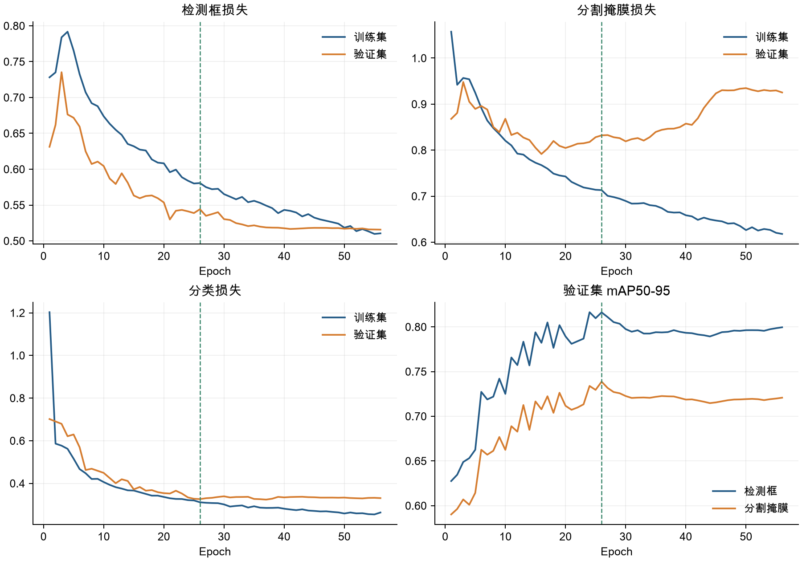

第26至56轮，训练Mask Loss从0.71319降至0.61805，验证Mask Loss从0.83214变为0.92533，验证Mask mAP50-95从0.73870变为0.72076。训练拟合继续改善，验证指标没有同步改善，呈现过拟合迹象。

第26轮后连续30轮没有刷新验证fitness，因此第56轮正常提前停止。当前框架的分割fitness为Box与Mask mAP50-95之和；最佳轮次已用CSV和原生早停日志共同核对。独立测试和预测均采用best.pt。

本次只训练一个随机种子。当前结果不能量化模型容量、类别不均衡及标注边界误差各自的影响。


---

## 独立测试与三种模型对照

使用同一独立测试集10,819张图像、15,659个实例。large采用验证集选出的best.pt；测试batch=16、imgsz=640。small、medium取自此前相同入口与设置下的完整测试，未重新训练。

| 指标 | YOLO26s | YOLO26m | YOLO26l |
| --- | --- | --- | --- |
| Box Precision | 0.93537 | 0.95092 | 0.91992 |
| Box Recall | 0.88338 | 0.87917 | 0.88456 |
| Box mAP50 | 0.93016 | 0.93611 | 0.92865 |
| Box mAP50-95 | 0.83570 | 0.84526 | 0.83708 |
| Mask Precision | 0.93485 | 0.95141 | 0.92917 |
| Mask Recall | 0.87939 | 0.87627 | 0.87094 |
| Mask mAP50 | 0.92682 | 0.93283 | 0.92490 |
| Mask mAP50-95 | 0.76066 | 0.76502 | 0.75943 |

### large测试集逐类别掩膜结果

| 类别 | 实例 | Precision | Recall | mAP50 | mAP50-95 |
| --- | --- | --- | --- | --- | --- |
| grasper | 8701 | 0.919 | 0.873 | 0.932 | 0.652 |
| hook | 4848 | 0.991 | 0.987 | 0.994 | 0.882 |
| irrigator | 1109 | 0.961 | 0.902 | 0.959 | 0.806 |
| clipper | 326 | 0.979 | 0.859 | 0.960 | 0.855 |
| bipolar | 526 | 0.950 | 0.907 | 0.948 | 0.683 |
| scissors | 149 | 0.775 | 0.698 | 0.756 | 0.679 |

large测试Mask mAP50-95为0.75943，比medium低约0.559个百分点。当前单次实验未观察到large带来总体分割提升，尚未进行多随机种子显著性检验。

逐类别掩膜mAP来自原生日志，只有显示精度；Ultralytics逐类别JSON中无前缀的mAP字段为检测框指标。验证与测试视频不同，分数差异不表示测试时进行了额外训练。


---

## 推理计时与模型规模

图2：三种模型的完整验证曲线及Batch=1、FP32平均延迟。

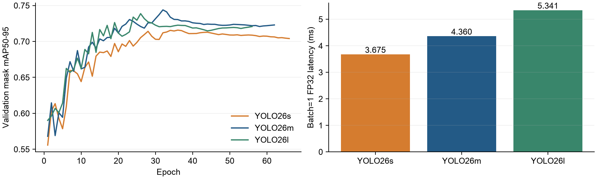

| 指标 | YOLO26s | YOLO26m | YOLO26l |
| --- | --- | --- | --- |
| 实际轮数 / 最佳轮次 | 66 / 36 | 62 / 32 | 56 / 26 |
| 训练耗时（小时） | 2.880 | 4.594 | 4.625 |
| 验证Mask mAP50-95 | 0.71575 | 0.74391 | 0.73870 |
| 测试Mask mAP50-95 | 0.76066 | 0.76502 | 0.75943 |
| 平均延迟（ms） | 3.675 | 4.360 | 5.341 |
| 中位延迟（ms） | 3.676 | 4.345 | 5.426 |
| P95延迟（ms） | 3.804 | 4.571 | 5.508 |
| 折算FPS | 272.093 | 229.360 | 187.237 |

三种模型均使用随机种子42选择的相同50张验证图像、10张预热、Batch=1、FP32和CUDA同步计时；读取的来源清单已核对一致。包含预处理、推理和后处理，排除文件解码、绘制及视频编码。small、medium沿用先前计时，large在训练结束后单独计时，运行时段不同。

每种模型只执行一组计时，未给出重复测量置信区间。折算FPS不代表完整视频处理速度。本次medium在测试分割指标上最高，small平均延迟最低；结论限定于当前数据划分与测量条件。


---

## 预测图片示例（一）

使用与此前报告相同的20张固定验证样本，按抽样顺序展示前8张。左侧原图，右侧为large第26轮best.pt的真实预测，imgsz=640、conf=0.25，在Mac CPU上生成。

样例01 | 预测1个器械实例

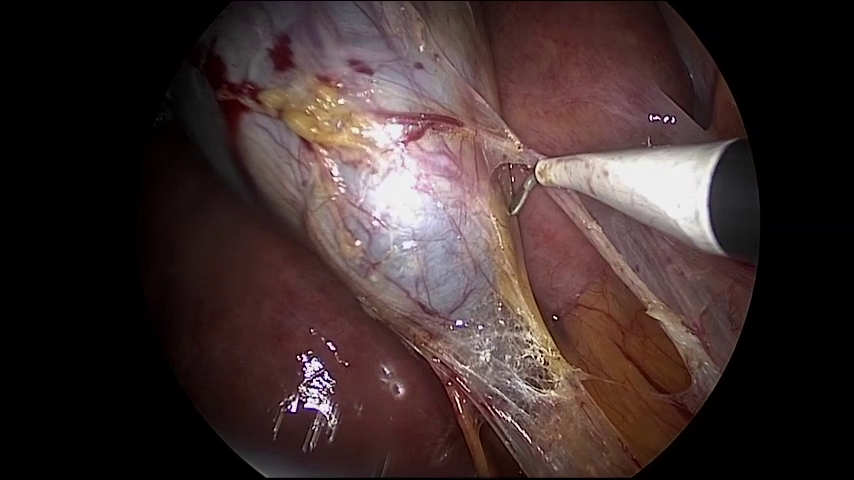

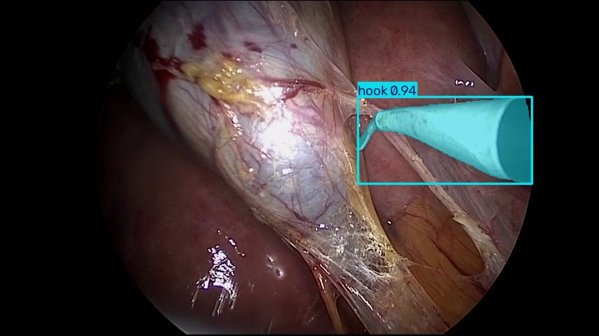

样例02 | 预测2个器械实例

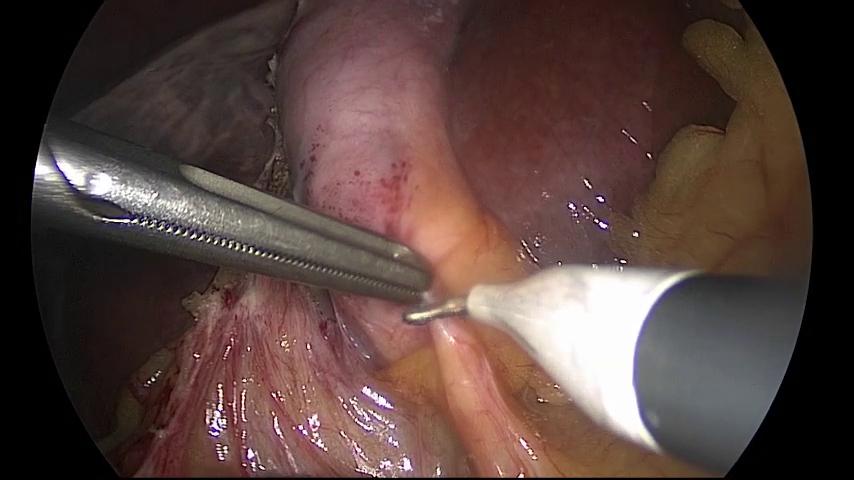

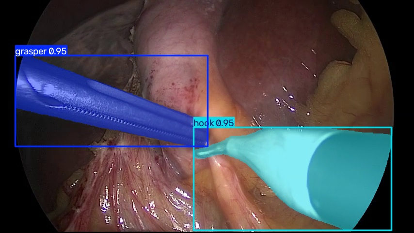

样例03 | 预测2个器械实例

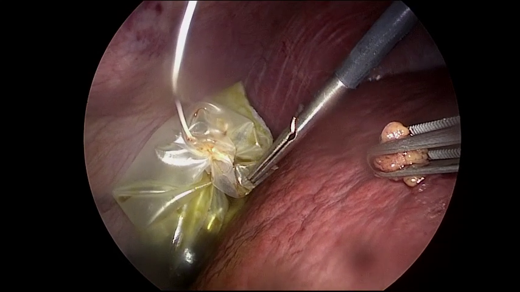

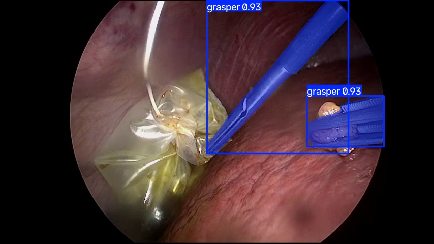

样例04 | 预测2个器械实例

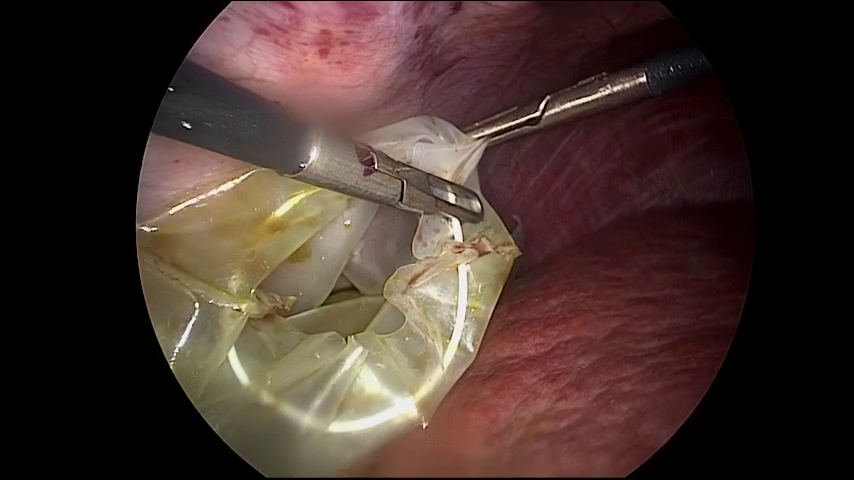

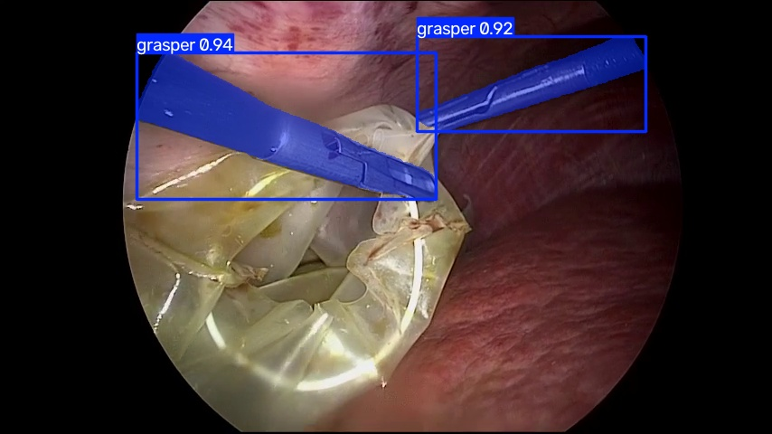


---

## 预测图片示例（二）

使用与此前报告相同的20张固定验证样本，按抽样顺序展示前8张。左侧原图，右侧为large第26轮best.pt的真实预测，imgsz=640、conf=0.25，在Mac CPU上生成。

样例05 | 预测3个器械实例

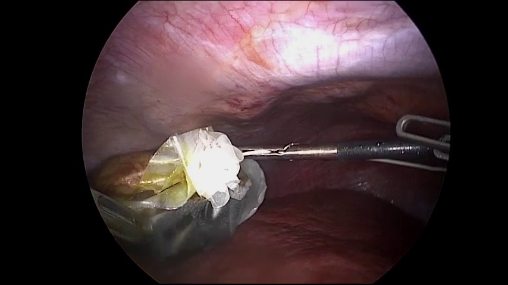

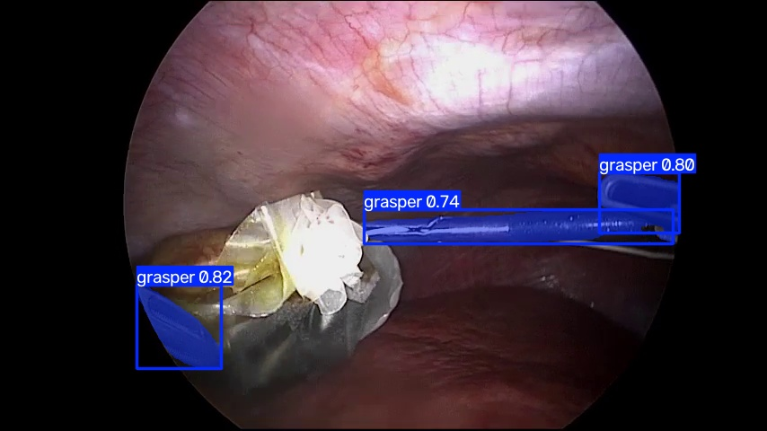

样例06 | 预测2个器械实例

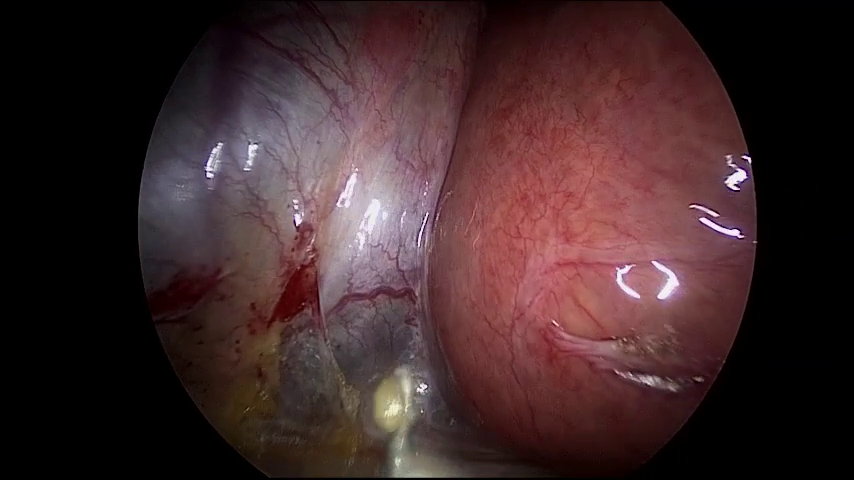

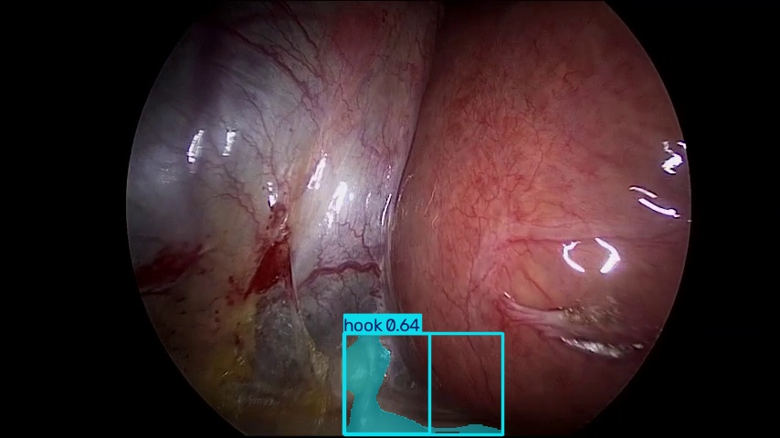

样例07 | 预测2个器械实例

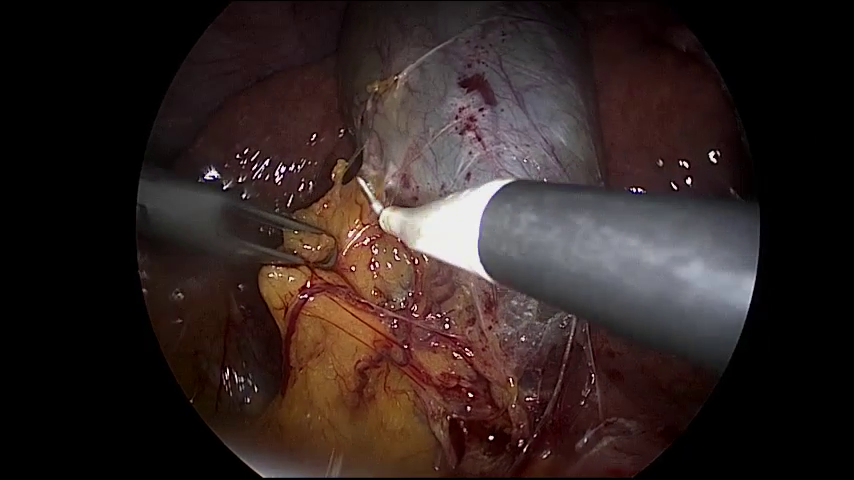

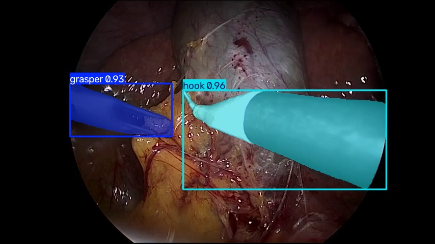

样例08 | 预测2个器械实例

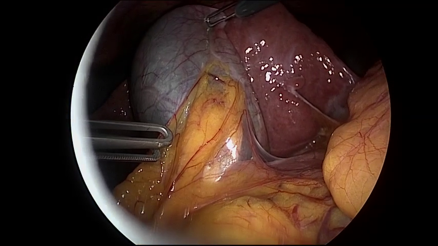

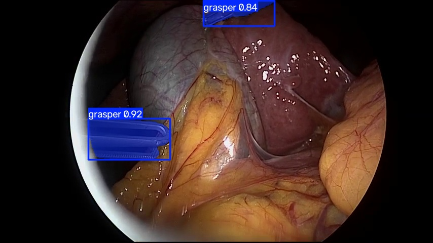


---

## 权重、归档与复现

best.pt对应第26轮，last.pt对应第56轮，均已清理优化器状态。阶段检查点共六个：epoch0.pt、epoch10.pt至epoch50.pt，对应完成第1、11、21、31、41、51轮。最新epoch50.pt保留优化器状态；恢复后仍受原早停条件控制。

| 材料 | 实验归档相对路径 |
| --- | --- |
| 最佳 / 最终权重 | weights/best.pt、weights/last.pt |
| 阶段检查点 | checkpoints/epoch50.pt等六个文件 |
| 代码与可迁移配置 | code/scripts/、code/configs/ |
| 实际配置与环境 | config/args.yaml、config/environment.json、依赖清单 |
| 逐轮记录 / 验证 | metrics/results.csv、best_epoch_validation_metrics.json |
| 独立测试 / 推理计时 | metrics/test-l.json、metrics/benchmark.json |
| 三模型对照 | metrics/comparison.json |
| 原始日志 / 数据核查 | logs/、data/ |

完整归档位于experiments/2026-11-02_yolo26l_cholec/。数据、类别与代码材料保留在本地项目中；报告材料保存固定图像和真实预测JSON。

```bash
.venv/bin/python scripts/download_weights.py --model yolo26l-seg
.venv/bin/python scripts/run.py train \
  --config configs/rtx4090.yaml \
  --weights weights/yolo26l-seg.pt --batch 16 \
  --name yolo26l-reproduce
```

### 发布材料与实验限制

GitHub目录包含代码、配置、数据核查摘要、逐轮结果、日志与本报告。Hugging Face目录包含large最佳、最终及六个阶段权重，模型说明、类别映射和评估结果。当前只准备本地文件，尚未远程发布。

仅有一个训练随机种子，尚未进行跨医院、跨设备或外部视频验证。snare缺少验证和测试实例，类别数量不均衡。预测样例用于展示输出，定量结论依据完整验证集与独立测试集。
