# CholecInstanceSeg YOLO26m-seg 全参数微调实验报告

实验日期：2026年11月2日。训练完成62轮，最佳模型来自第32轮。

## 数据来源与标注

使用CholecInstanceSeg公开数据的官方图像、实例标注及元数据。图像源文件为cholecinstance_seg_reference_image_set.zip，标注源文件为cholecinstanceseg.zip，元数据为cholecinstanceseg_metadata.csv。作者项目为github.com/cai4cai/cholec_instance_seg，原始文件与转换后的完整数据保存在本地项目datasets/cholecinstanceseg/。

本次逐张解码并核对全部41,933帧图像，检查图像与标注的配对、尺寸、类别和实例编号。原始实例由类别与group_id共同确定，同类别的多个器械分别保留。共核查64,755个实例，未配对图像为0。原始标注保留，训练使用转换后的YOLO多边形标签。

| 集合 | 图像数 | 实例数 | 无器械图像 | 视频编号数 |
| --- | --- | --- | --- | --- |
| train | 26830 | 42716 | 2542 | 45 |
| val | 4284 | 6380 | 542 | 18 |
| test | 10819 | 15659 | 1830 | 22 |

沿用作者提供的序列划分；按文件名中的视频编号进一步核查，训练、验证和测试的视频编号没有交集。无器械图像保留为空标签样本。训练使用全部训练集，验证集用于模型选择，独立测试集尚未执行评估。

## 类别与实例分布

| ID | 器械类别 | 英文名称 | 训练实例 | 验证实例 | 测试实例 |
| --- | --- | --- | --- | --- | --- |
| 0 | 抓钳 | grasper | 25698 | 4017 | 8701 |
| 1 | 电钩 | hook | 12675 | 1759 | 4848 |
| 2 | 冲洗吸引器 | irrigator | 1189 | 122 | 1109 |
| 3 | 施夹器 | clipper | 899 | 99 | 326 |
| 4 | 双极器械 | bipolar | 1762 | 270 | 526 |
| 5 | 剪刀 | scissors | 450 | 113 | 149 |
| 6 | 圈套器 | snare | 43 | 0 | 0 |

grasper与hook占训练实例的主要部分。snare只有43个训练实例，验证集与测试集均为0；报告中的总体验证指标不能用于说明snare的识别或分割能力。


---

## 标注转换与完整性核查

转换程序按类别和group_id合并同一器械的轮廓，使用Shapely修复无效几何并裁剪到图像范围；保留内部孔洞、离散区域及需要保留的细线。多段轮廓使用Ultralytics官方merge_multi_segment连接，输出归一化的YOLO分割坐标。

独立验证重新读取实际保存的TXT标签，使用官方polygon2mask还原掩膜，与原始实例标注逐实例比较，并核对类别、图像尺寸、实例关联、文件数量和视频划分。原始图像尺寸为854×480、1920×1080；下表的转换IoU在对应原始图像网格上计算。

| 核查项目 | 结果 |
| --- | --- |
| 全部实例平均还原IoU | 0.99971728 |
| 按实例面积加权还原IoU | 0.99989545 |
| 最小实例还原IoU | 0.87465691 |
| 还原IoU低于0.95的实例 | 31 / 64,755 |
| 未解释像素差异 | 0 |
| 转换检查失败 / 未配对图像 | 0 / 0 |
| 官方数据加载器核对 | 三个集合均无图像或实例丢失 |

31个较低IoU实例主要受到小实例、离散轮廓连接线与栅格化的影响，记录在data/low_iou_instances.json。转换几何的连接前检查与连接线新增像素分别核查。转换还原IoU描述标签表示误差，与模型预测的分割IoU含义不同。

## GPU与软件环境

| 项目 | 实际环境 |
| --- | --- |
| 操作系统 | Linux-6.17.0-1025-oem-x86_64-with-glibc2.39 |
| CPU / 内存 | Intel Core i9-14900K / 128GB |
| GPU | NVIDIA GeForce RTX 4090 |
| NVIDIA驱动 | 580.105.08（服务器登录检查） |
| Python | 3.12.3 |
| PyTorch / torchvision | 2.14.1+cu126 / 0.29.1+cu126 |
| CUDA运行时 | 12.6 |
| Ultralytics | 8.4.190 |
| PyTorch可见显存 | 23.516 GiB |
| CUDA前向与反向检查 | 通过，计算结果与梯度均为有限值 |

依赖在Linux虚拟环境中安装；完整服务器版本记录为config/server-requirements.lock.txt，安装日志为logs/setup.log。


---

## 模型与训练配置

从Ultralytics官方COCO预训练yolo26m-seg.pt开始新的七类别分割实验。训练日志记录329层、26,980,745个参数与同数量梯度参数，freeze=0。最终验证时的融合结构为146层、23,512,865个参数；训练结构与融合推理结构的参数数量分别记录。

| 参数 | 实际设置 |
| --- | --- |
| Task / 模型 | segment / YOLO26m-seg |
| 最大Epoch / 实际Epoch | 150 / 62 |
| 最佳Epoch / 提前停止 | 32 / patience=30 |
| Image Size / Batch Size | 640 / 16 |
| nbs / 梯度累积 | 64 / 预热后约4个批次 |
| Optimizer | MuSGD，显式指定 |
| lr0 / momentum / weight_decay | 0.01 / 0.9 / 0.0005 |
| AMP / CUDA | True / device 0 |
| Workers / Seed | 8 / 42 |
| Freeze / deterministic | 0 / True |
| Warmup Epoch | 3.0 |
| 学习率安排 | 线性衰减，cos_lr=False，lrf=0.01 |
| Mosaic / close_mosaic | mosaic=1.0，close_mosaic=10 |
| 其他主要增强 | fliplr=0.5，translate=0.1，scale=0.5 |
| mask_ratio / overlap_mask | 4 / True |
| 图像缓存 | cache=False |
| 阶段检查点 | save_period=10 |
| 模型选择 | Ultralytics验证fitness，保存best.pt |

实际完整参数保存在config/args.yaml。优化器初始化日志记录144组无衰减权重、164组带0.0005衰减的权重及164组偏置；不同参数组的学习率不完全相同，实际值见results.csv。

close_mosaic=10按150轮计划在最后10轮关闭Mosaic；本次第62轮提前停止，没有进入该阶段。日志中没有发生正式训练的Mosaic关闭事件。

正式训练从原始COCO预训练权重加载，三轮诊断测量的权重未用于正式训练。预测示例统一使用第32轮的best.pt。


---

## 训练过程与耗时

训练于北京时间2026年11月2日约02:34在tmux会话yolo-train中启动，约07:10完成。原生日志记录62轮耗时4.594小时；results.csv累计时间为16,538.3秒。按3.41元/小时折算，正式训练费用约15.67元，上传、安装和诊断测量费用另计。

| 项目 | 实际结果 |
| --- | --- |
| 每轮训练批次 / 验证批次 | 1,677 / 134 |
| 62轮训练批次总数 | 103,974 |
| 训练图像呈现次数 | 1,663,460 |
| 每轮平均 / 中位耗时 | 266.75 / 266.30 秒 |
| 最快 / 最慢轮次耗时 | 265.97 / 285.38 秒 |
| 完整逐轮数值检查 | 62轮全部损失、指标和学习率均为有限值 |

批次迭代次数与优化器更新次数分别计算。预热后约每4个训练批次累积一次梯度；预热期间累积步长变化，未从批次数量推断精确优化器更新总数。

| Epoch | 每轮秒数 | 训练Box Loss | 训练Mask Loss | 验证Mask Loss | Mask mAP50-95 |
| --- | --- | --- | --- | --- | --- |
| 1 | 285.38 | 0.73587 | 1.06463 | 0.88827 | 0.56804 |
| 10 | 266.67 | 0.67108 | 0.81345 | 0.85083 | 0.66185 |
| 20 | 266.57 | 0.61211 | 0.74120 | 0.81661 | 0.71175 |
| 30 | 266.23 | 0.56768 | 0.68726 | 0.84191 | 0.73161 |
| 32 | 266.57 | 0.56109 | 0.68147 | 0.84270 | 0.74391 |
| 40 | 266.20 | 0.54463 | 0.65920 | 0.86761 | 0.72596 |
| 50 | 266.50 | 0.52266 | 0.62889 | 0.90506 | 0.72290 |
| 60 | 266.30 | 0.50568 | 0.61678 | 0.92923 | 0.72194 |
| 62 | 266.20 | 0.50609 | 0.60652 | 0.93413 | 0.72295 |

### 显存记录的统计范围

正式训练前三轮的外部GPU采样记录整卡占用峰值18,173MiB，约17.75GiB。完整62轮训练日志显示，PyTorch保留显存的最高观测值约21.4GiB，出现在第53轮，终端数值存在舍入。两项统计范围与口径不同，前三轮整卡采样没有覆盖完整训练。

本次62轮训练正常结束，未发生CUDA显存溢出。报告不把前三轮的显存采样值当作整个实验的整卡峰值。


---

## 最佳模型验证指标

模型选择使用完整4,284张验证图像、6,380个实例。下表为results.csv第32轮的原始精度记录，数值范围0-1。训练结束后框架自动重新验证best.pt，日志中的整体结果分别约为Box mAP50-95=0.825、Mask mAP50-95=0.744，与逐轮记录接近。

| 指标 | Box | Mask |
| --- | --- | --- |
| Precision | 0.97058 | 0.96976 |
| Recall | 0.84221 | 0.84120 |
| mAP50 | 0.91397 | 0.91084 |
| mAP50-95 | 0.82479 | 0.74391 |

以下逐类别结果来自训练结束后的best.pt原生验证日志，保留其显示精度，末尾补零用于排版。snare在验证集中没有真值实例，逐类别表不列入该类别。

### 检测框逐类别结果

| 类别 | 验证实例 | Precision | Recall | mAP50 | mAP50-95 |
| --- | --- | --- | --- | --- | --- |
| grasper | 4017 | 0.950 | 0.930 | 0.965 | 0.817 |
| hook | 1759 | 0.990 | 0.986 | 0.994 | 0.913 |
| irrigator | 122 | 0.958 | 0.934 | 0.968 | 0.888 |
| clipper | 99 | 0.979 | 0.926 | 0.978 | 0.928 |
| bipolar | 270 | 0.966 | 0.848 | 0.915 | 0.789 |
| scissors | 113 | 0.980 | 0.432 | 0.665 | 0.612 |

### 分割掩膜逐类别结果

| 类别 | 验证实例 | Precision | Recall | mAP50 | mAP50-95 |
| --- | --- | --- | --- | --- | --- |
| grasper | 4017 | 0.950 | 0.929 | 0.956 | 0.703 |
| hook | 1759 | 0.990 | 0.986 | 0.994 | 0.882 |
| irrigator | 122 | 0.958 | 0.932 | 0.964 | 0.854 |
| clipper | 99 | 0.979 | 0.926 | 0.978 | 0.873 |
| bipolar | 270 | 0.962 | 0.844 | 0.908 | 0.630 |
| scissors | 113 | 0.980 | 0.432 | 0.665 | 0.524 |

总体Precision较高，Recall低于Precision。scissors的验证召回约0.432、Mask mAP50-95约0.524，低于其他已评估类别；bipolar的Mask mAP50-95约0.630。该差异提示需要重点检查这些类别的漏检及分割，但仅凭汇总指标无法确定具体失败原因。


---

## Loss与收敛分析

图1：62轮真实训练与验证曲线。绿色虚线标出最佳第32轮；曲线直接来自results.csv，没有模拟、填补或平滑。

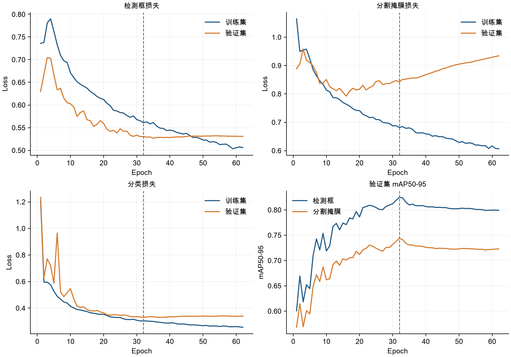

第32至62轮，训练Mask Loss从0.68147下降到0.60652，验证Mask Loss从0.84270上升到0.93413，验证Mask mAP50-95从0.74391下降到0.72295，下降约2.10个百分点。训练拟合继续改善，但验证表现没有同步改善，呈现过拟合迹象。

训练Box Loss同期从0.56109降至0.50609，Box mAP50-95从0.82479降至0.79911。模型保存与停止由验证fitness控制，不能用训练损失持续下降推断需要更多轮次。

第32轮之后连续30轮没有刷新最佳fitness，因此第62轮触发提前停止。该结果说明本次训练达到设置的停止条件；它没有证明所有训练配置都应固定为62轮，也没有证明继续到150轮能够提升验证性能。


---

## 最佳轮次之后的验证变化

图2：第20至62轮的验证Mask mAP50-95局部曲线。阴影覆盖最佳第32轮之后的观测区间。

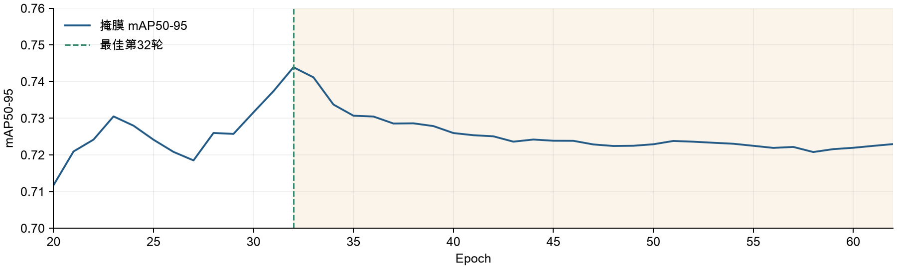

| 项目 | 第32轮 best | 第62轮 last |
| --- | --- | --- |
| 训练Mask Loss | 0.68147 | 0.60652 |
| 验证Mask Loss | 0.84270 | 0.93413 |
| Mask mAP50 | 0.91084 | 0.88115 |
| Mask mAP50-95 | 0.74391 | 0.72295 |

正式训练全程使用同一最大轮次计划与Mosaic配置；第32轮后指标退化不能解释为关闭Mosaic造成的突变。类别不均衡、视频场景差异与小实例边界误差都可能影响验证表现，当前实验没有单独控制这些因素来确定因果贡献。

## 验证阶段GPU推理耗时

| 阶段 | 原生验证日志显示的每图平均耗时 |
| --- | --- |
| 预处理 | 0.1 ms |
| 模型推理 | 1.6 ms |
| 损失计算 | 0.0 ms（显示精度） |
| 后处理 | 0.3 ms |

以上来自训练结束后best.pt对完整验证集的原生评估，设置的验证批量为32。该记录没有提供Batch=1同步计时、P95延迟或完整视频处理速度，报告不据此给出单帧实时FPS。

本报告另外在Mac CPU上生成20张验证图片的真实预测，用于展示模型输出。该步骤与服务器GPU验证的计时口径不同，未作为GPU性能基准。


---

## 预测图片示例（一）

固定随机种子42，从完整验证集随机抽取20张。报告按抽样顺序展示前8张，左侧原图，右侧为本次best.pt预测的边界框、类别、置信度和实例掩膜；conf=0.25，imgsz=640。

样例01 | VID23 | 预测1个实例

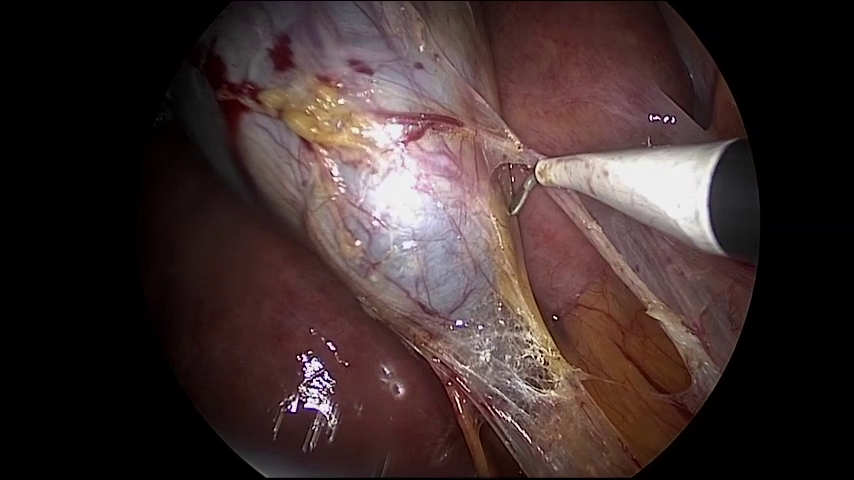

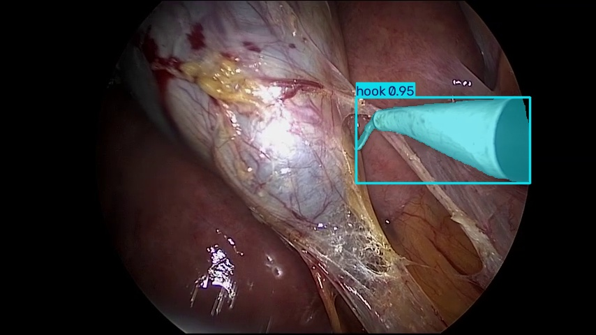

样例02 | VID11 | 预测2个实例

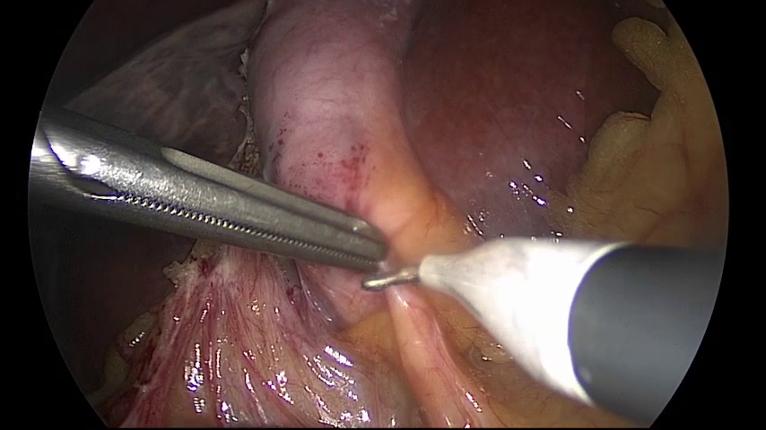

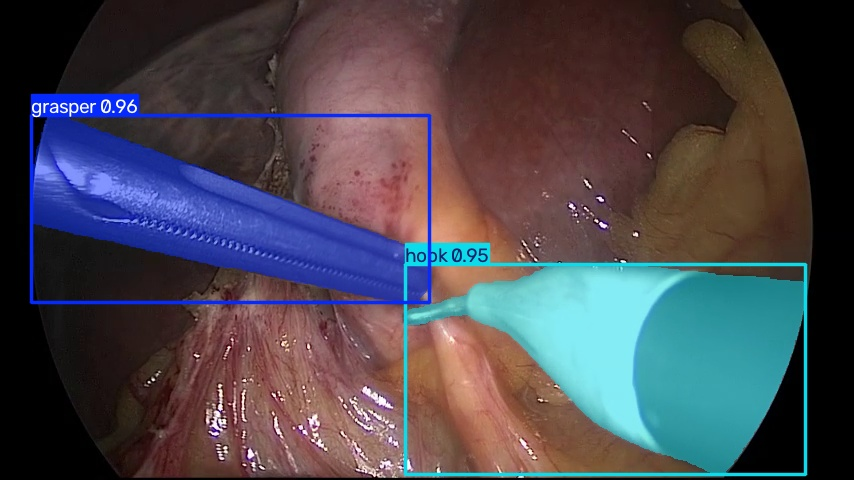

样例03 | VID23 | 预测2个实例

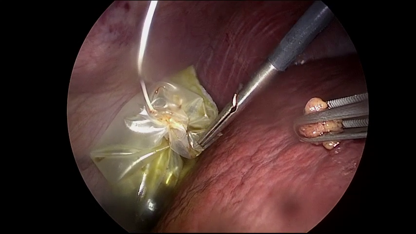

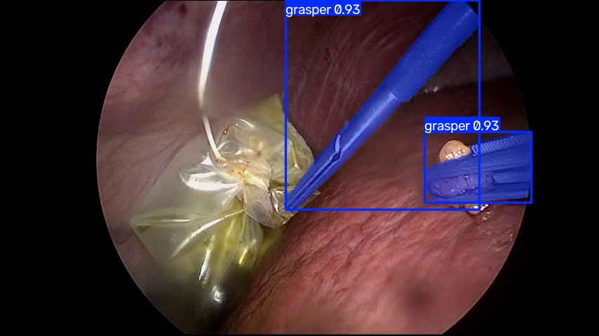

样例04 | VID23 | 预测2个实例

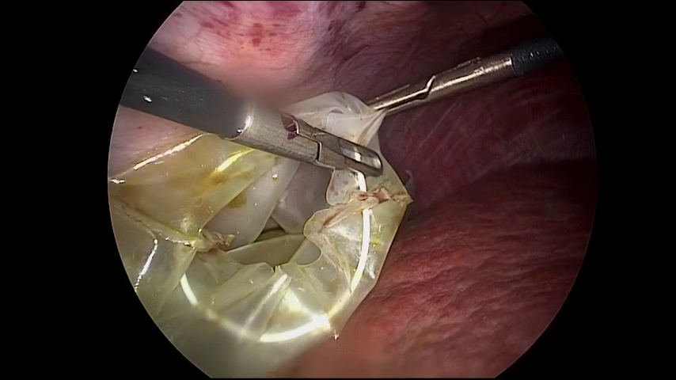

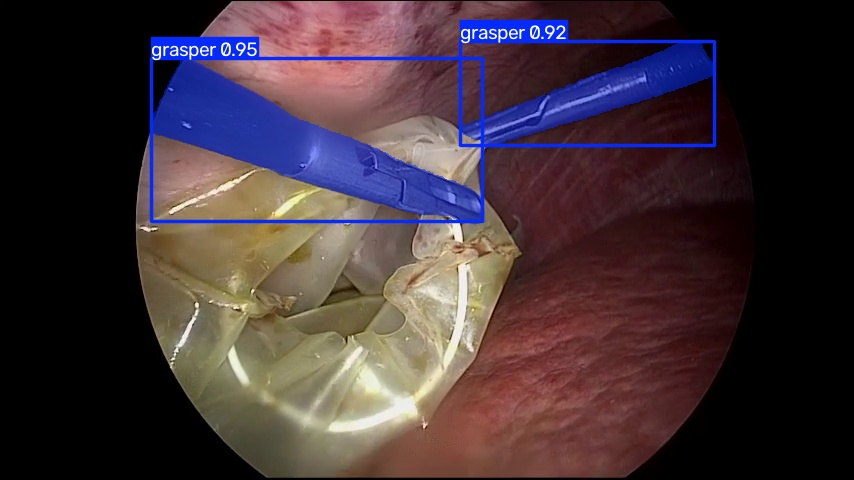


---

## 预测图片示例（二）

固定随机种子42，从完整验证集随机抽取20张。报告按抽样顺序展示前8张，左侧原图，右侧为本次best.pt预测的边界框、类别、置信度和实例掩膜；conf=0.25，imgsz=640。

样例05 | VID23 | 预测3个实例

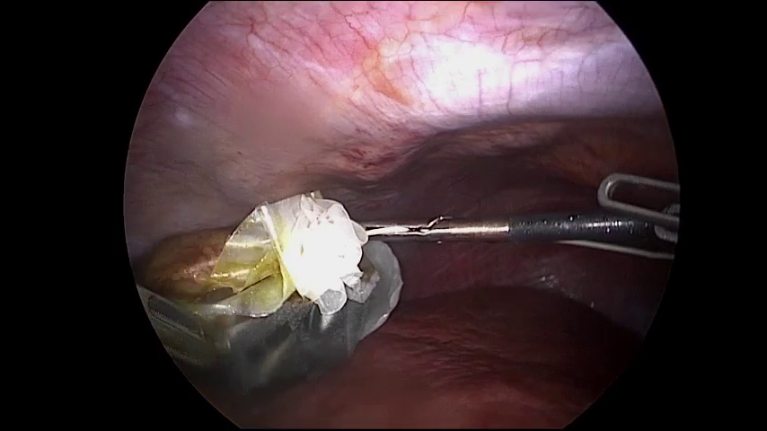

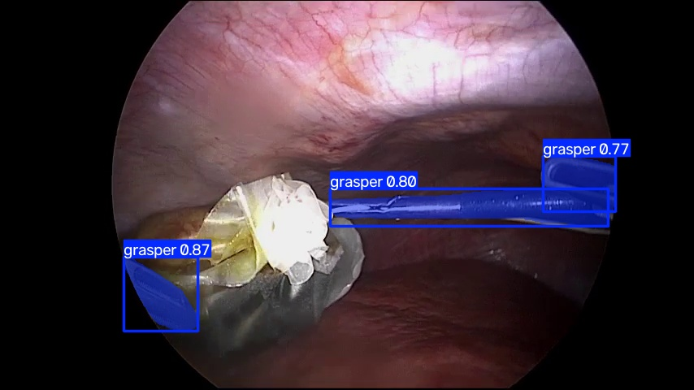

样例06 | VID23 | 预测1个实例

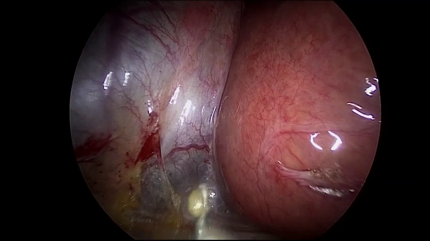

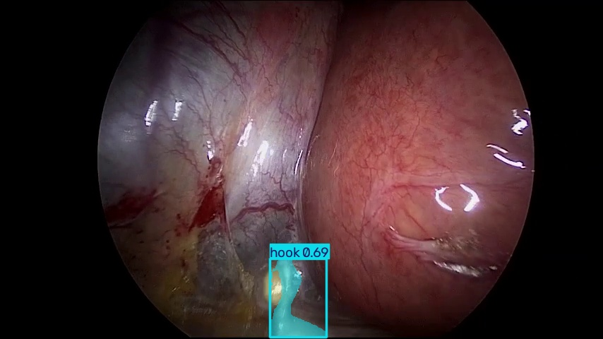

样例07 | VID23 | 预测2个实例

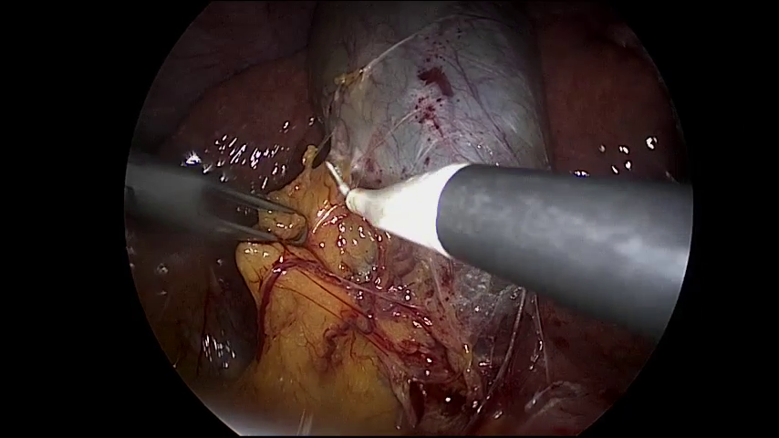

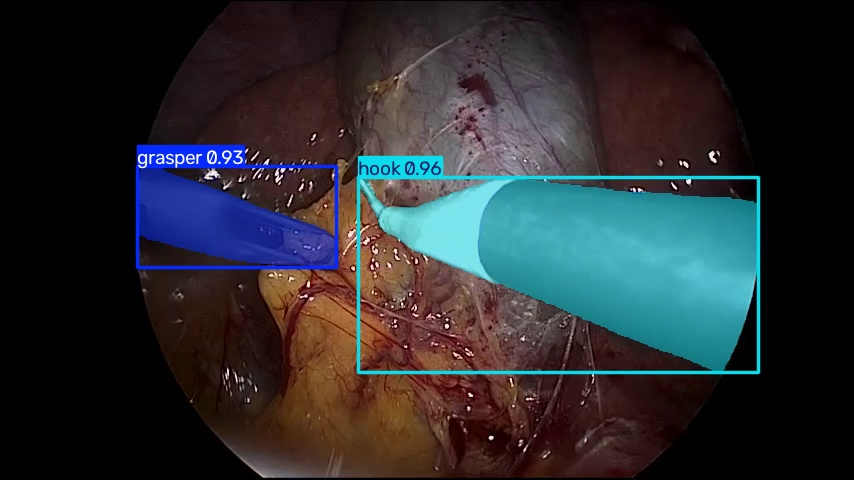

样例08 | VID23 | 预测2个实例

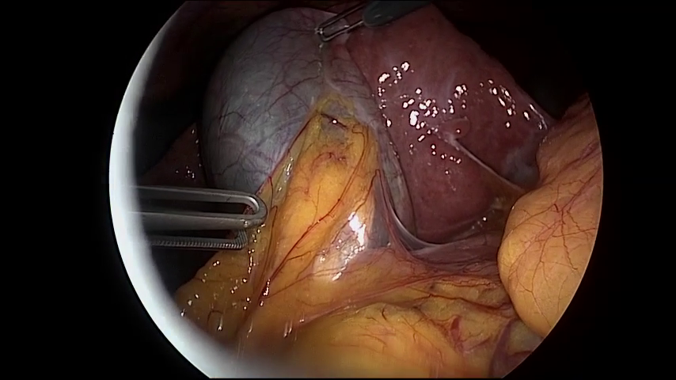

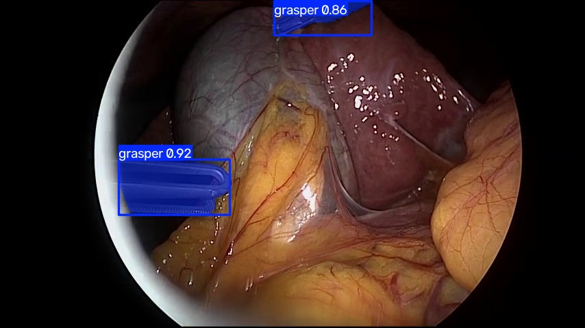


---

## 权重、日志与复现

best.pt来自第32轮，last.pt来自第62轮，文件均约54.48MB。另保存epoch0.pt、epoch10.pt、epoch20.pt、epoch30.pt、epoch40.pt、epoch50.pt、epoch60.pt，共7份阶段检查点，每份约162.5MB。原生文件名使用从0开始的轮次编号，分别对应完成第1、11、21、31、41、51、61轮。

本地已读取验证best.pt和epoch60.pt。best.pt与last.pt在正常结束后清理优化器状态；epoch60.pt保留完整优化器状态，对应已完成61轮。恢复阶段检查点仍受原提前停止配置控制。

| 材料 | 归档相对路径 |
| --- | --- |
| 最佳 / 最终权重 | weights/best.pt、weights/last.pt |
| 完整续训检查点 | checkpoints/epoch60.pt |
| 实际配置 / Linux依赖 | config/args.yaml、config/server-requirements.lock.txt |
| 62轮指标 / 最佳轮次指标 | metrics/results.csv、metrics/best_epoch_validation_metrics.json |
| 训练日志 / 简明日志 | logs/rtx4090-train.log、logs/training_events.txt |
| 数据转换与验证记录 | data/conversion.jsonl、data/verification.json |
| 训练代码与配置快照 | code/scripts/、code/configs/ |
| 文件清单与备份核查 | archive_inventory.json、verification.json |

上表归档根目录为experiments/2026-11-02_yolo26m_cholec/。在具有相同CUDA环境及完整数据的yolofinetune根目录执行下列训练命令，使用独立实验名称。

```bash
.venv/bin/python scripts/run.py train \
  --config configs/rtx4090.yaml --batch 16 \
  --name rtx4090-reproduce
```

## 实验限制与后续评估

独立测试集10,819帧尚未评估，报告结论限定于当前验证划分。当前模型未进行不同医院、设备或手术场景的外部验证；验证集选择模型与参数的过程也限制了对泛化能力的直接判断。

类别分布明显不均衡，snare缺少验证与测试实例，scissors召回较低；仍需按类别检查漏检、遮挡和细小部件。转换存在少量连接线与栅格化误差，报告没有额外计算基于原始Mask的实例面积加权Dice或预测IoU。

预测图片仅展示模型输出，未额外导出预测视频。完整20张样例、原始预测JSON及抽样来源保存在本报告assets/目录；定量结论使用完整验证集，图片示例不构成独立性能评估。


## 数据与证据来源

- 作者数据项目：https://github.com/cai4cai/cholec_instance_seg
- 基础预训练权重：https://github.com/ultralytics/assets/releases/download/v8.4.0/yolo26m-seg.pt
- 本地实验产物：../../experiments/2026-11-02_yolo26m_cholec/
- 本报告统计：assets/report_facts.json
