# CholecInstanceSeg YOLO26s-seg 全参数微调与模型规模对照实验报告

实验日期：2026年11月2日。s模型训练66轮，最佳第36轮；m模型为相同数据与参数下的参照。

## 数据来源与标注

使用CholecInstanceSeg官方图像、实例JSON及元数据，作者项目为github.com/cai4cai/cholec_instance_seg。沿用已经完成完整解码、实例关联与标签还原验证的数据，训练和模型选择前未更改训练、验证及测试划分。

| 集合 | 图像 | 实例 | 无器械图像 |
| --- | --- | --- | --- |
| train | 26830 | 42716 | 2542 |
| val | 4284 | 6380 | 542 |
| test | 10819 | 15659 | 1830 |

按视频编号核查三个集合没有交集。训练、验证、测试分别包含45、18、22个视频编号，共85个。验证集用于选择best.pt；s模型训练完成后，两个模型的best.pt才统一在独立测试集上评估，测试结果未用于本次训练参数选择。

## 类别与实例分布

| ID | 器械类别 | 英文名称 | 训练实例 | 验证实例 | 测试实例 |
| --- | --- | --- | --- | --- | --- |
| 0 | 抓钳 | grasper | 25698 | 4017 | 8701 |
| 1 | 电钩 | hook | 12675 | 1759 | 4848 |
| 2 | 冲洗吸引器 | irrigator | 1189 | 122 | 1109 |
| 3 | 施夹器 | clipper | 899 | 99 | 326 |
| 4 | 双极器械 | bipolar | 1762 | 270 | 526 |
| 5 | 剪刀 | scissors | 450 | 113 | 149 |
| 6 | 圈套器 | snare | 43 | 0 | 0 |

snare只有43个训练实例，验证集与测试集均无实例。本报告的总体和逐类别评估不能用于说明该类别的泛化能力。grasper、hook与其他类别之间也存在明显的实例数量差异。


---

## 标注转换与完整性核查

每个类别与group_id对应一个器械实例。同类别的多个器械分别保留；Shapely修复无效几何并裁剪到图像范围，保留孔洞、离散区域及细线。离散轮廓通过Ultralytics官方merge_multi_segment连接，输出归一化YOLO多边形。

独立验证重新解码全部输出图像，读取实际保存的TXT并还原掩膜；核对尺寸、类别、实例数与官方数据加载器。图像尺寸包含854×480与1920×1080。转换误差在原始图像网格上统计，描述标签编码误差。

| 核查项目 | 结果 |
| --- | --- |
| 图像 / 实例总数 | 41,933 / 64,755 |
| 未配对图像 / 转换检查失败 | 0 / 0 |
| 平均还原IoU | 0.99971728 |
| 面积加权还原IoU | 0.99989545 |
| 最小实例还原IoU | 0.87465691 |
| 最终还原IoU低于0.95 | 31个实例 |
| 未解释像素差异 | 0 |

较低IoU主要受到小实例、多段轮廓连接线与栅格化影响；完整逐实例记录保存在本地归档data/conversion.jsonl，较低IoU清单为data/low_iou_instances.json。

## GPU与软件环境

| 项目 | 实际环境 |
| --- | --- |
| GPU / CPU / 内存 | RTX 4090 24GB / i9-14900K / 128GB |
| 系统 | Linux-6.17.0-1025-oem-x86_64-with-glibc2.39 |
| Python / Ultralytics | 3.12.3 / 8.4.190 |
| PyTorch / torchvision | 2.14.1+cu126 / 0.29.1+cu126 |
| CUDA运行时 / 驱动 | 12.6 / 580.105.08 |
| PyTorch可见显存 | 23.516GiB |
| CUDA前向与反向计算 | 已通过，结果与梯度均为有限值 |


---

## 模型与训练配置

从官方COCO预训练yolo26s-seg.pt开始七类别全参数微调。训练日志记录11,439,881个参数与同数量梯度参数，freeze=0。融合推理结构为136层、10,368,049个参数。

| 参数 | 实际设置 |
| --- | --- |
| 最大Epoch / 实际Epoch | 150 / 66 |
| 最佳Epoch / 提前停止 | 36 / patience=30 |
| Image Size / Batch Size | 640 / 16 |
| nbs / 梯度累积 | 64 / 预热后约4个批次 |
| Optimizer / 初始学习率 | MuSGD / lr0=0.01 |
| momentum / weight_decay | 0.9 / 0.0005 |
| AMP / Device | True / CUDA:0 |
| Workers / Seed | 8 / 42 |
| Freeze / deterministic | 0 / True |
| Warmup | 3.0轮 |
| 学习率安排 | 线性衰减，lrf=0.01，cos_lr=False |
| Mosaic / close_mosaic | 1.0 / 10 |
| 主要其他增强 | fliplr=0.5，translate=0.1，scale=0.5 |
| Mask设置 | mask_ratio=4，overlap_mask=True |
| 阶段保存 / 图像缓存 | save_period=10 / cache=False |

s、m两次训练的24项实际配置已逐项核对一致，涵盖数据路径、轮次上限、批量、优化器、学习率、增强、随机种子和分割设置。模型采用各自对应的COCO预训练权重，数据划分保持相同。

close_mosaic=10按150轮计划在最后10轮关闭Mosaic；本次在第66轮提前停止，未进入关闭阶段。短测量设置close_mosaic=0，使三轮测量保持Mosaic开启；测量权重未用于正式训练。


---

## 训练过程、耗时与显存

正式训练于北京时间2026年11月2日12:53在tmux会话yolo26s-train中启动，约15:46完成；随后完成两个模型的独立测试与GPU计时，完整流程约15:48结束。本地备份约15:50完成。

| 项目 | 实际结果 |
| --- | --- |
| 正式训练累计时间 | 10,367.8秒，约2小时53分钟 |
| 每轮平均 / 中位耗时 | 157.09 / 156.80秒 |
| 最快 / 最慢轮次 | 156.43 / 172.96秒 |
| 每轮训练 / 验证批次 | 1,677 / 134 |
| 66轮训练批次总数 | 110,682 |
| 图像呈现次数 | 1,770,780 |
| 日志保留显存最高观测值 | 约12.5GiB，终端显示有舍入 |
| 全部逐轮数值检查 | 损失、指标和学习率均为有限值 |

按3.41元/小时折算，正式训练费用约9.82元，上传、三轮诊断、最终测试和备份费用另计。训练批次数与优化器更新次数分别统计；预热期间累积步长变化，报告不从批次数推断精确更新总数。

| Epoch | 每轮秒数 | 训练Box Loss | 训练Mask Loss | 验证Mask Loss | Mask mAP50-95 |
| --- | --- | --- | --- | --- | --- |
| 1 | 172.96 | 0.80107 | 1.13946 | 0.92275 | 0.55582 |
| 10 | 156.97 | 0.71543 | 0.86458 | 0.84884 | 0.64413 |
| 20 | 156.96 | 0.64794 | 0.78835 | 0.81639 | 0.68570 |
| 30 | 156.63 | 0.60895 | 0.73707 | 0.85932 | 0.70301 |
| 36 | 156.48 | 0.59465 | 0.72163 | 0.85280 | 0.71575 |
| 40 | 156.59 | 0.58175 | 0.70611 | 0.86475 | 0.71097 |
| 50 | 156.59 | 0.56023 | 0.67564 | 0.88568 | 0.70896 |
| 60 | 156.77 | 0.54143 | 0.66583 | 0.89843 | 0.70732 |
| 66 | 156.80 | 0.53019 | 0.64637 | 0.91201 | 0.70405 |


---

## 最佳模型验证指标

best.pt来自第36轮。整体精度来自results.csv对应轮次，验证集共4,284张图像、6,380个实例。训练结束后框架重新验证best.pt，日志整体Mask mAP50-95约0.716，与逐轮记录接近。

| 指标 | Box | Mask |
| --- | --- | --- |
| Precision | 0.95170 | 0.95304 |
| Recall | 0.83091 | 0.83027 |
| mAP50 | 0.88758 | 0.88575 |
| mAP50-95 | 0.79621 | 0.71575 |

逐类别结果来自best.pt原生验证日志，保留其显示精度，末尾补零用于排版；snare没有验证实例，未列入表格。

### 检测框逐类别结果

| 类别 | 验证实例 | Precision | Recall | mAP50 | mAP50-95 |
| --- | --- | --- | --- | --- | --- |
| grasper | 4017 | 0.938 | 0.924 | 0.958 | 0.806 |
| hook | 1759 | 0.986 | 0.984 | 0.993 | 0.906 |
| irrigator | 122 | 0.934 | 0.921 | 0.955 | 0.887 |
| clipper | 99 | 0.974 | 0.929 | 0.978 | 0.927 |
| bipolar | 270 | 0.928 | 0.837 | 0.915 | 0.760 |
| scissors | 113 | 0.956 | 0.387 | 0.527 | 0.488 |

### 分割掩膜逐类别结果

| 类别 | 验证实例 | Precision | Recall | mAP50 | mAP50-95 |
| --- | --- | --- | --- | --- | --- |
| grasper | 4017 | 0.936 | 0.921 | 0.949 | 0.688 |
| hook | 1759 | 0.986 | 0.983 | 0.993 | 0.879 |
| irrigator | 122 | 0.933 | 0.920 | 0.955 | 0.842 |
| clipper | 99 | 0.974 | 0.929 | 0.978 | 0.874 |
| bipolar | 270 | 0.933 | 0.841 | 0.913 | 0.598 |
| scissors | 113 | 0.956 | 0.387 | 0.527 | 0.413 |

scissors在验证集上的召回约0.387，Mask mAP50-95约0.413，是本次验证中的主要短板；bipolar的Mask mAP50-95约0.598。汇总指标不能确定具体漏检或边界失配原因。


---

## Loss与收敛分析

图1：66轮真实训练与验证曲线，绿色虚线为最佳第36轮。曲线直接使用原始CSV数值，没有模拟、填补或平滑。

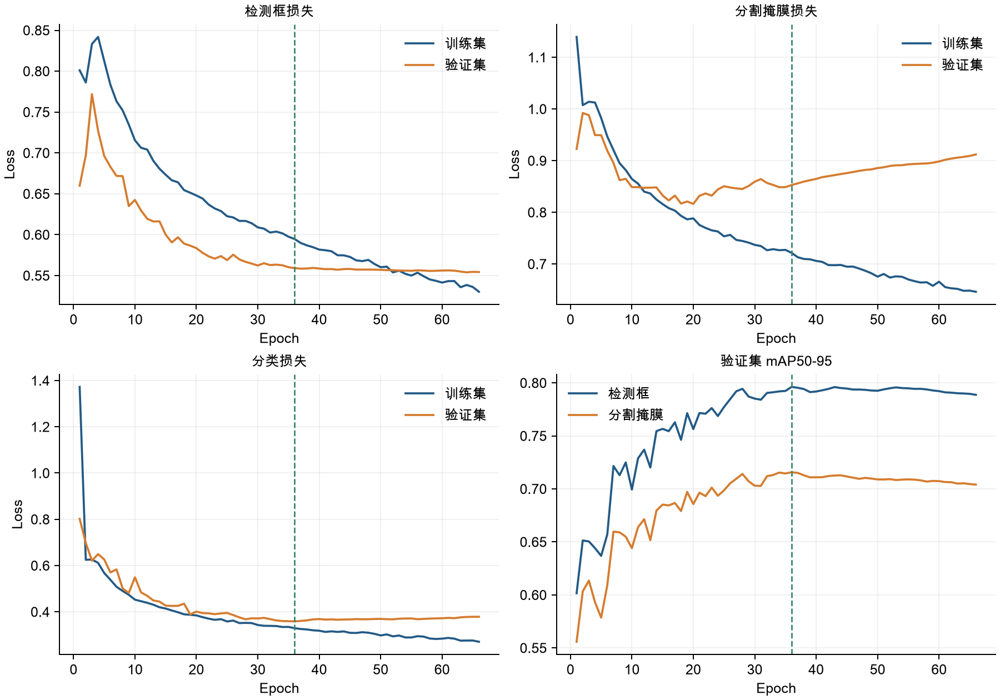

第36至66轮，训练Mask Loss从0.72163降到0.64637，验证Mask Loss从0.85280升到0.91201，验证Mask mAP50-95从0.71575降到0.70405，下降约1.17个百分点。训练拟合继续改善，验证表现没有同步改善，呈现过拟合迹象。

第36轮之后连续30轮没有刷新最佳验证fitness，因此第66轮正常提前停止。最终测试与预测均采用best.pt。实际停止轮数由本次验证变化决定，不能把66轮解释为所有配置的最佳训练长度。

本次未进入最后10轮的Mosaic关闭阶段，后期验证下降没有对应的数据增强切换事件。当前没有多随机种子重复实验，也没有单独控制类别采样或标注边界误差来量化它们的贡献。


---

## 独立测试集：s与m同条件对照

两个模型均使用各自在验证集上选出的best.pt，对同一独立测试集10,819张图像、15,659个实例进行评估。测试批量16、imgsz=640，评估入口和其余设置相同；指标来自本次完整测试JSON。差值为s减m，单位为百分点。

| 指标 | YOLO26m | YOLO26s | 差值（百分点） |
| --- | --- | --- | --- |
| Box Precision | 0.95092 | 0.93537 | -1.554 |
| Box Recall | 0.87917 | 0.88338 | +0.421 |
| Box mAP50 | 0.93611 | 0.93016 | -0.594 |
| Box mAP50-95 | 0.84526 | 0.83570 | -0.957 |
| Mask Precision | 0.95141 | 0.93485 | -1.656 |
| Mask Recall | 0.87627 | 0.87939 | +0.312 |
| Mask mAP50 | 0.93283 | 0.92682 | -0.601 |
| Mask mAP50-95 | 0.76502 | 0.76066 | -0.436 |

### 测试集逐类别掩膜结果

| 类别 | 实例 | m召回 | s召回 | m mAP50-95 | s mAP50-95 |
| --- | --- | --- | --- | --- | --- |
| grasper | 8701 | 0.871 | 0.877 | 0.652 | 0.645 |
| hook | 4848 | 0.986 | 0.985 | 0.880 | 0.882 |
| irrigator | 1109 | 0.893 | 0.908 | 0.804 | 0.796 |
| clipper | 326 | 0.873 | 0.876 | 0.867 | 0.863 |
| bipolar | 526 | 0.897 | 0.892 | 0.691 | 0.682 |
| scissors | 149 | 0.738 | 0.738 | 0.696 | 0.696 |

逐类别掩膜mAP来自原生终端日志，只有显示精度。当前Ultralytics summary JSON中的无前缀mAP字段表示检测框指标，报告没有将其当作掩膜mAP。

本次测试Mask mAP50-95为m=0.76502、s=0.76066，差约0.436个百分点。验证集和测试集来自不同视频集合，分数高低不能解释为测试时模型得到了额外训练。snare仍缺少测试实例。


---

## GPU推理性能与模型规模取舍

图2：相同数据上的验证曲线及Batch=1、FP32平均延迟。两个模型使用同样50张真实验证图像进行计时。

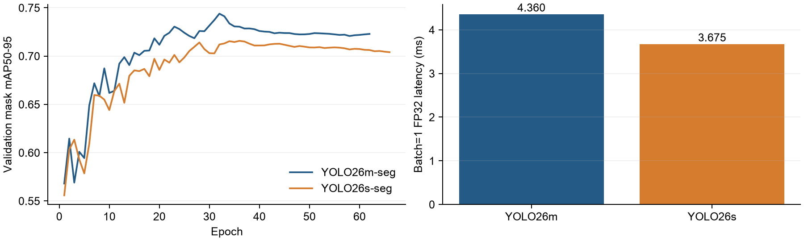

| 指标 | YOLO26m | YOLO26s |
| --- | --- | --- |
| 计时样本 / 预热样本 | 50 / 10 | 50 / 10 |
| Batch / imgsz / 精度 | 1 / 640 / FP32 | 1 / 640 / FP32 |
| 平均延迟（ms） | 4.360 | 3.675 |
| 中位延迟（ms） | 4.345 | 3.676 |
| P95延迟（ms） | 4.571 | 3.804 |
| 按平均延迟折算FPS | 229.36 | 272.09 |
| 分配显存峰值（GiB） | 0.2007 | 0.1138 |
| 保留显存峰值（GiB） | 0.2344 | 0.1406 |
| 实际训练轮数 / 耗时 | 62 / 4.594小时 | 66 / 2.880小时 |

计时前完成文件解码，使用CUDA同步包围每次预测，包含预处理、GPU推理与后处理，排除绘制与视频编码。上述FPS不代表完整视频处理速度。只执行一组50张计时，尚未给出重复测量的置信区间，且模型测试顺序固定。

在当前测试与计时条件下，s的平均延迟比m低约15.71%，测试Mask mAP50-95低约0.436个百分点。结果支持把s作为低延迟候选，把m作为精度优先候选；尚无多随机种子实验，不能宣称二者精度在统计上等效。


---

## 预测图片示例（一）

使用与m报告相同的随机种子42和20张验证样本，报告按抽样顺序展示前8张。左侧原图，右侧为第36轮s模型best.pt的真实预测，conf=0.25、imgsz=640；样例在Mac CPU上生成，未用于GPU计时。

样例01 | VID23 | 预测1个实例

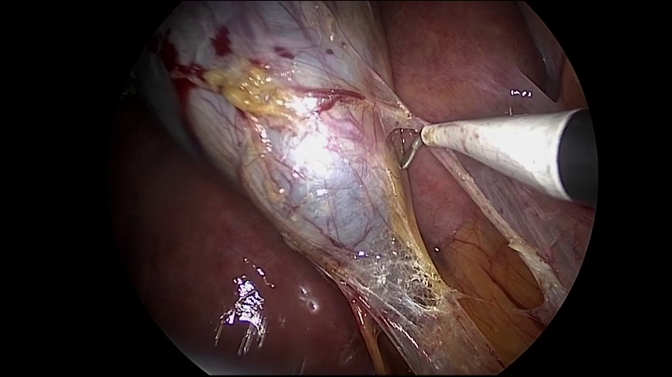

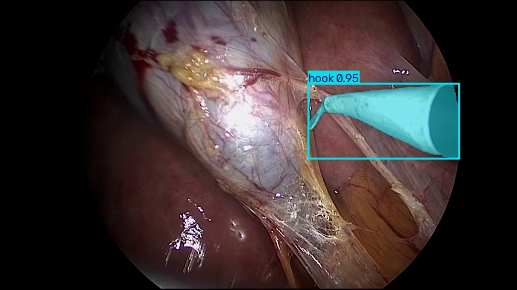

样例02 | VID11 | 预测2个实例

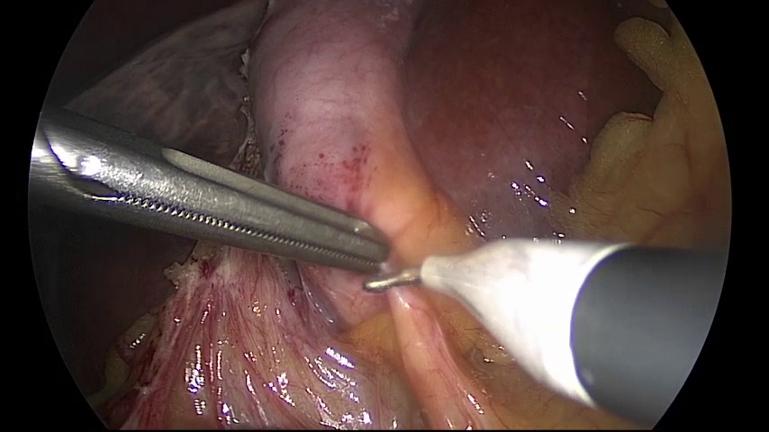

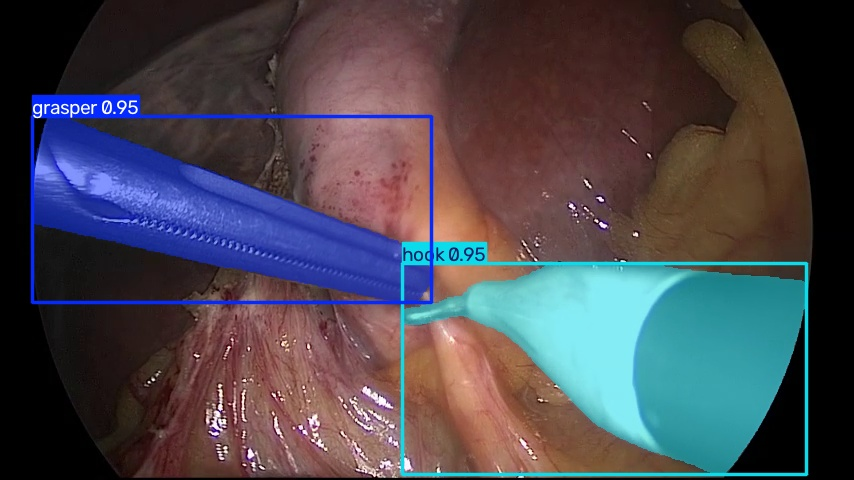

样例03 | VID23 | 预测2个实例

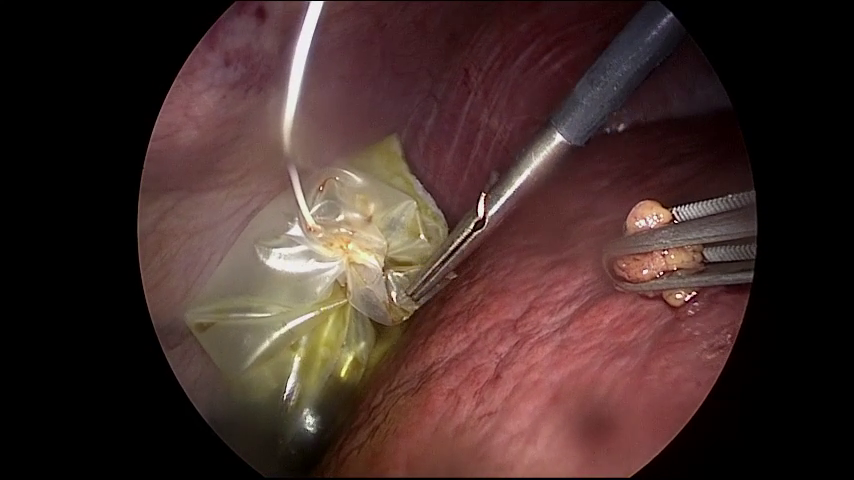

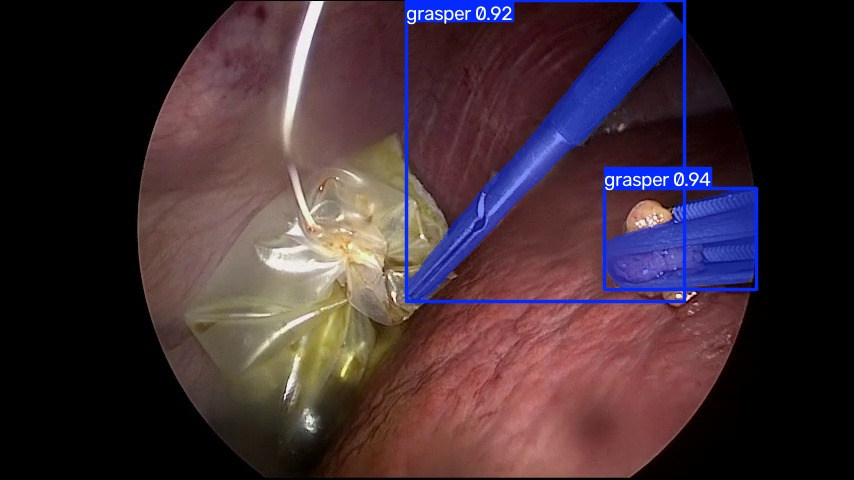

样例04 | VID23 | 预测2个实例

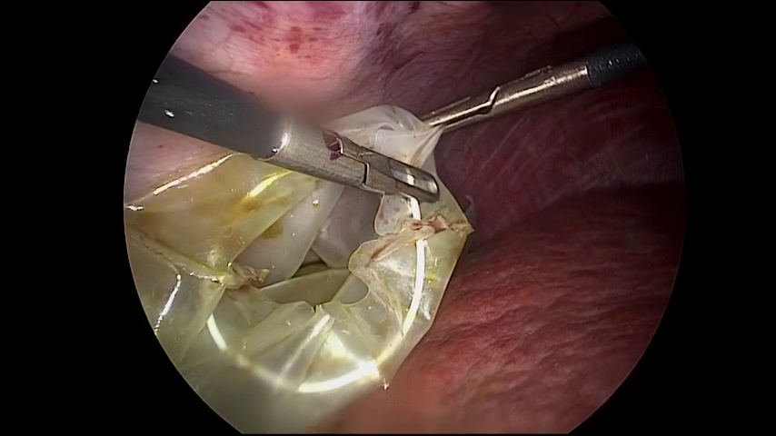

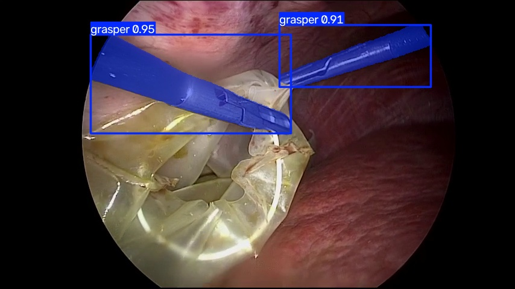


---

## 预测图片示例（二）

使用与m报告相同的随机种子42和20张验证样本，报告按抽样顺序展示前8张。左侧原图，右侧为第36轮s模型best.pt的真实预测，conf=0.25、imgsz=640；样例在Mac CPU上生成，未用于GPU计时。

样例05 | VID23 | 预测5个实例

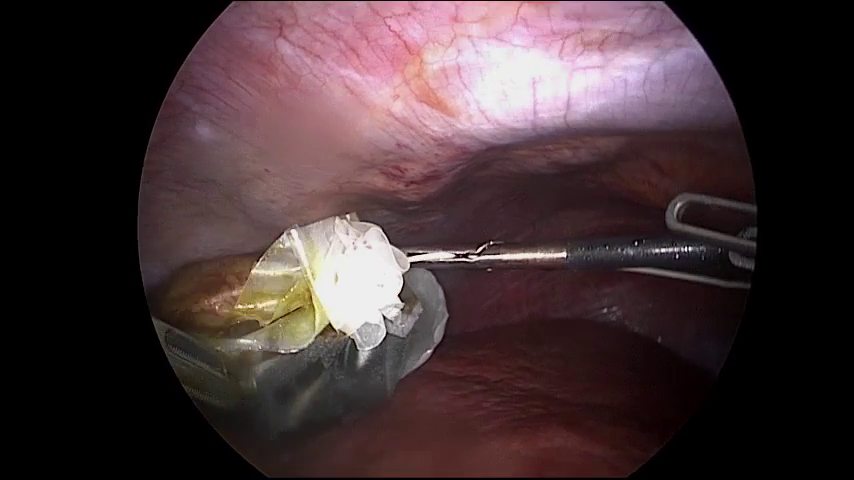

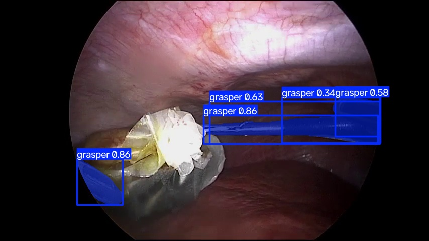

样例06 | VID23 | 预测1个实例

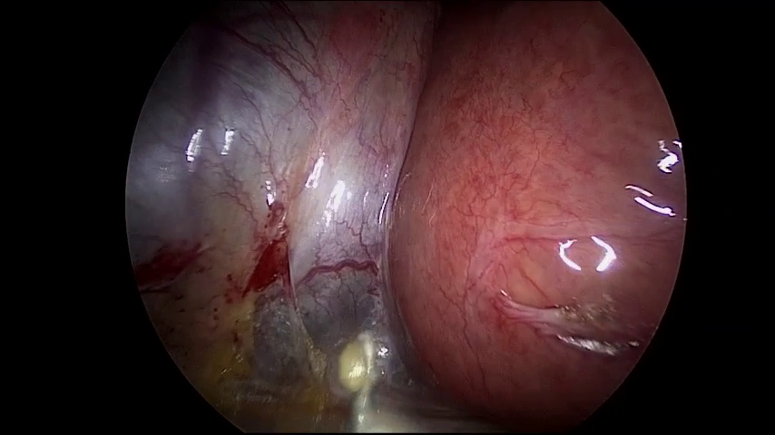

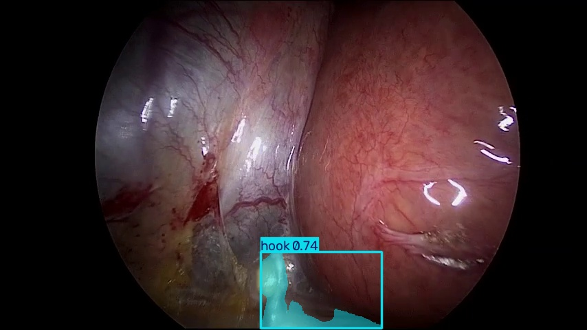

样例07 | VID23 | 预测2个实例

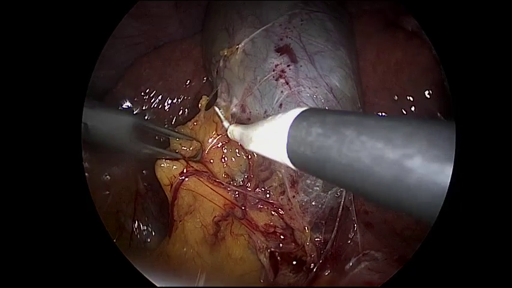

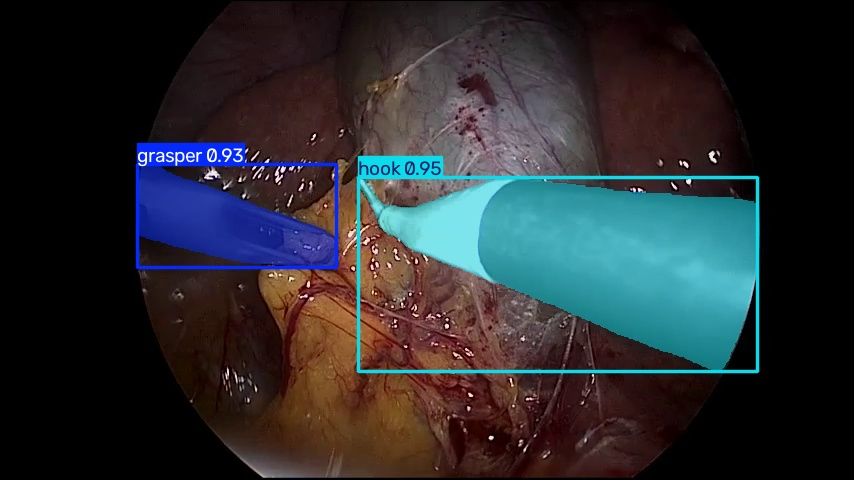

样例08 | VID23 | 预测2个实例

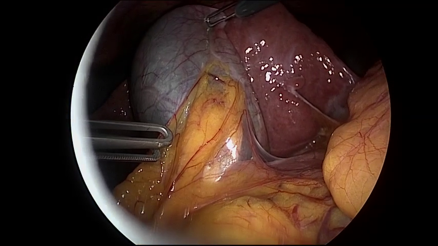

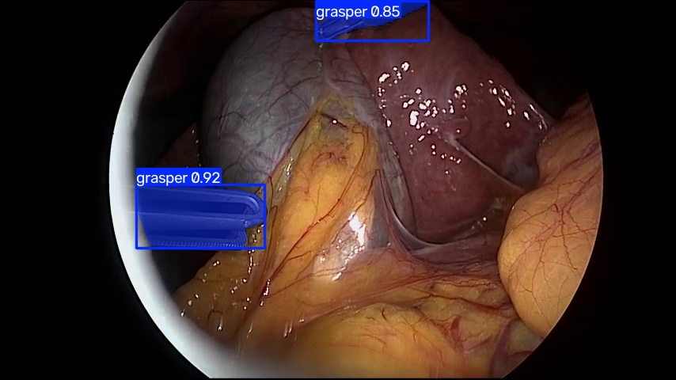


---

## 权重、日志与复现

best.pt对应第36轮，last.pt对应第66轮，均已清理优化器状态。全部7个阶段检查点为epoch0.pt、epoch10.pt至epoch60.pt，使用从0开始的编号，对应完成第1、11、21、31、41、51、61轮。最新epoch60.pt保留完整优化器状态；恢复后仍受原提前停止设置控制。

| 材料 | 本地归档相对路径 |
| --- | --- |
| 最佳 / 最终权重 | weights/best.pt、weights/last.pt |
| 完整续训检查点 | checkpoints/epoch60.pt |
| 实际配置与依赖 | config/args.yaml、config/server-requirements.lock.txt |
| 66轮训练记录 | metrics/results.csv |
| 验证 / 独立测试 | metrics/best_epoch_validation_metrics.json、metrics/test-s.json |
| m参照测试 / 推理基准 | metrics/test-m.json、metrics/benchmark.json |
| 完整对照数据 | metrics/comparison.json |
| 原始训练日志 | logs/training.log |

归档根目录为experiments/2026-11-02_yolo26s_cholec/。下列命令在具备完整数据与CUDA环境的项目根目录运行；使用新的实验名称。

```bash
.venv/bin/python scripts/run.py train \
  --config configs/rtx4090.yaml \
  --weights weights/yolo26s-seg.pt --batch 16 \
  --name yolo26s-reproduce
```

### 实验限制与发布材料

本次只训练一个随机种子。两个模型的训练样本、参数及测试口径相同，支持当前划分上的模型规模对照，但尚未开展跨医院、跨设备或外部视频验证，也未计算原始Mask面积加权Dice。

GitHub本地目录集中保存代码、配置、数据处理摘要、结果、日志及本报告；Hugging Face按s、m分别保存权重、阶段检查点、模型说明和类别映射。全部内容先保存在本地，本报告生成过程未执行远程发布。

类别不均衡与snare缺少验证、测试实例仍是主要限制。预测样例只展示模型输出，定量结论来自完整验证集和独立测试集。
