# CholecInstanceSeg YOLO26-seg 手术器械识别与实例分割综合实验报告

实验日期：2026年11月2日；报告日期：2026年11月3日。三个模型均已完成训练与独立测试，本报告根据本地保存的CSV、配置、日志及真实预测汇编。

## 实验任务与数据划分

任务为识别腹腔镜手术图像中的器械类别，并输出每个器械的独立分割掩膜。比较YOLO26s-seg、YOLO26m-seg、YOLO26l-seg在相同数据划分和训练设置下的精度、资源消耗及推理速度。三组分别从对应的官方COCO预训练权重开始全参数微调。

使用CholecInstanceSeg官方图像、实例JSON和元数据，作者项目：github.com/cai4cai/cholec_instance_seg。数据按视频编号划分，三个集合没有视频编号交集。

| 集合 | 视频编号数 | 图像数 | 实例数 | 无器械图像 |
| --- | --- | --- | --- | --- |
| train | 45 | 26830 | 42716 | 2542 |
| val | 18 | 4284 | 6380 | 542 |
| test | 22 | 10819 | 15659 | 1830 |

### 类别与实例分布

| ID | 英文类别 | 训练实例 | 验证实例 | 测试实例 |
| --- | --- | --- | --- | --- |
| 0 | grasper | 25698 | 4017 | 8701 |
| 1 | hook | 12675 | 1759 | 4848 |
| 2 | irrigator | 1189 | 122 | 1109 |
| 3 | clipper | 899 | 99 | 326 |
| 4 | bipolar | 1762 | 270 | 526 |
| 5 | scissors | 450 | 113 | 149 |
| 6 | snare | 43 | 0 | 0 |

snare仅有43个训练实例，验证和测试均无该类实例；总体指标不能反映snare的泛化能力。三个集合共41,933张图像、64,755个器械实例。


---

## 数据转换、核查与软件环境

每个类别与group_id共同确定一个器械实例。通过Shapely修复并裁剪几何，使用Ultralytics官方merge_multi_segment连接离散轮廓，输出归一化YOLO分割多边形。同类别多个器械分别保留。

独立核查逐张解码输出图像，从实际保存的TXT还原掩膜，核对尺寸、类别、图像配对与实例数。三次训练复用同一套转换结果，本报告没有重新生成数据集副本。

| 核查项目 | 结果 |
| --- | --- |
| 图像 / 实例总数 | 41,933 / 64,755 |
| 原始图像尺寸 | 854×480、1920×1080 |
| 未配对 / 转换检查失败 | 0 / 0 |
| 平均 / 面积加权还原IoU | 0.99971728 / 0.99989545 |
| 最小实例还原IoU | 0.87465691 |
| 还原IoU低于0.95 / 未解释差异 | 31个实例 / 0 |

还原IoU衡量标签表示误差，与模型预测质量分别解释。完整逐实例记录保存在实验归档data/conversion.jsonl。

### 实际服务器环境

| 项目 | 设置 |
| --- | --- |
| GPU / CPU / 内存 | RTX 4090 24GB / i9-14900K / 128GB |
| 操作系统 / Python | Ubuntu 24.04 / 3.12.3 |
| PyTorch / torchvision | 2.14.1+cu126 / 0.29.1+cu126 |
| Ultralytics | 8.4.190 |
| CUDA运行时 / NVIDIA驱动 | 12.6 / 580.105.08 |
| PyTorch可见显存 | 约23.516GiB |
| 执行方式 | tmux后台训练，AMP检查通过 |


---

## 训练控制条件与模型规模

三份实际args.yaml共核对114项：111项完全相同，仅model、name、save_dir不同，分别对应模型权重、实验名称和输出目录。

| 共享参数 | 实际设置 |
| --- | --- |
| 最大Epoch / patience | 150 / 30 |
| imgsz / batch / nbs | 640 / 16 / 64 |
| 优化器 / 初始学习率 | MuSGD / lr0=0.01 |
| momentum / weight_decay | 0.9 / 0.0005 |
| warmup_epochs / lrf / cos_lr | 3.0 / 0.01 / False |
| AMP / workers / freeze | True / 8 / 0 |
| seed / deterministic | 42 / True |
| mosaic / close_mosaic | 1.0 / 10 |
| fliplr / translate / scale | 0.5 / 0.1 / 0.5 |
| mask_ratio / overlap_mask | 4 / True |
| save_period / cache | 10 / False |

### 七类别训练结构与权重文件

| 模型 | 训练参数量 | best.pt大小 | 最佳轮次 |
| --- | --- | --- | --- |
| YOLO26s-seg | 11.440M | 22.25MiB | 36 |
| YOLO26m-seg | 26.981M | 51.96MiB | 32 |
| YOLO26l-seg | 31.384M | 60.49MiB | 26 |

参数量取自七类别训练日志，包含训练期间使用的结构；与官方80类别融合推理模型参数量的统计口径不同。best.pt已在训练正常结束后清理优化器状态。

预热之后梯度累积约4个训练批次。close_mosaic=10按150轮计划在最后10轮关闭，三组均提前停止，均未进入这一阶段。实际训练长度由相同早停规则决定。


---

## 训练耗时、显存与检查点对照

图1：每轮平均耗时包含训练与验证；显存为完整训练日志中的最高保留显存显示值，有舍入。

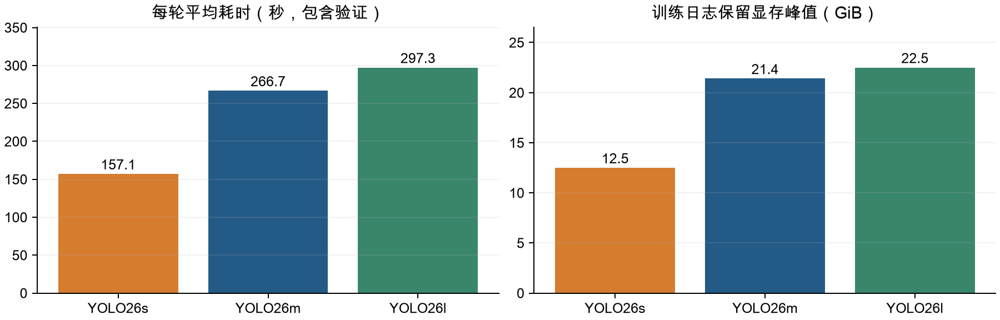

| 项目 | YOLO26s | YOLO26m | YOLO26l |
| --- | --- | --- | --- |
| 完成轮数 / 最佳轮次 | 66 / 36 | 62 / 32 | 56 / 26 |
| 训练累计时间（小时） | 2.880 | 4.594 | 4.625 |
| 平均每轮（秒） | 157.09 | 266.75 | 297.32 |
| 每轮中位耗时（秒） | 156.80 | 266.30 | 296.90 |
| 保留显存峰值（GiB） | 12.5 | 21.4 | 22.5 |
| 训练批次总数 | 110,682 | 103,974 | 93,912 |
| 图像呈现次数 | 1,770,780 | 1,663,460 | 1,502,480 |
| 阶段检查点数量 | 7 | 7 | 6 |
| 费用折算（元） | 9.82 | 15.67 | 15.77 |

三次正式训练累计约12.10小时；按3.41元/小时折算约41.26元。上传、环境安装、预先测量、独立测试、备份和空闲时间另计，不能将这个折算值当作平台总账单。

每轮训练1,677个批次、验证134个批次。预热期间累积步长变化，训练批次数不能直接当作优化器更新次数。small平均每轮耗时较短；large与medium总耗时接近，但large完成轮数更少。


---

## 最佳模型验证集指标对照

三组均根据验证fitness选择best.pt。当前分割fitness为Box与Mask mAP50-95之和，最佳轮次分别为small第36轮、medium第32轮、large第26轮。下表取对应轮次CSV原始精度，完整验证集为4,284张图像、6,380个实例。

| 指标 | YOLO26s | YOLO26m | YOLO26l |
| --- | --- | --- | --- |
| Box Precision | 0.95170 | 0.97058 | 0.96037 |
| Box Recall | 0.83091 | 0.84221 | 0.84905 |
| Box mAP50 | 0.88758 | 0.91397 | 0.91125 |
| Box mAP50-95 | 0.79621 | 0.82479 | 0.81624 |
| Mask Precision | 0.95304 | 0.96976 | 0.96093 |
| Mask Recall | 0.83027 | 0.84120 | 0.84631 |
| Mask mAP50 | 0.88575 | 0.91084 | 0.90765 |
| Mask mAP50-95 | 0.71575 | 0.74391 | 0.73870 |

图2：三个模型在验证集与独立测试集上的Box、Mask mAP50-95。纵轴从0开始，数值标签保留三位小数。

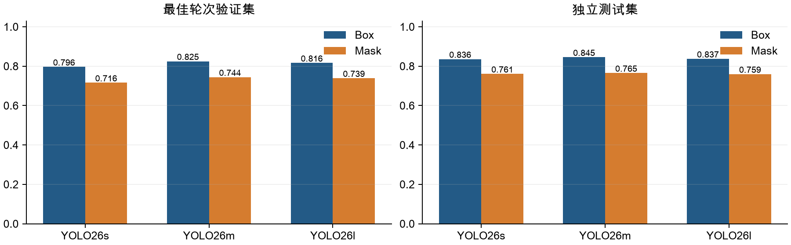

当前验证Mask mAP50-95以medium最高，比small高约2.816个百分点，比large高约0.521个百分点。较高Precision伴随较低Recall，表示漏检仍需结合逐类别结果判断。

表格中的Precision和Recall来自框架评估选定的工作点，与预测样例固定conf=0.25的工作点不同。mAP反映跨置信度排序的性能。


---

## 独立测试集指标与差值

三种模型各自采用验证集选出的best.pt，对同一10,819张测试图像、15,659个实例进行评估；imgsz=640、batch=16、相同入口与环境。small和medium的测试在先前对照流程中完成，large训练完成后单独测试。

| 指标 | YOLO26s | YOLO26m | YOLO26l |
| --- | --- | --- | --- |
| Box Precision | 0.93537 | 0.95092 | 0.91992 |
| Box Recall | 0.88338 | 0.87917 | 0.88456 |
| Box mAP50 | 0.93016 | 0.93611 | 0.92865 |
| Box mAP50-95 | 0.83570 | 0.84526 | 0.83708 |
| Mask Precision | 0.93485 | 0.95141 | 0.92917 |
| Mask Recall | 0.87939 | 0.87627 | 0.87094 |
| Mask mAP50 | 0.92682 | 0.93283 | 0.92490 |
| Mask mAP50-95 | 0.76066 | 0.76502 | 0.75943 |

### 相对medium的变化

| 指标差值（百分点） | small - medium | large - medium |
| --- | --- | --- |
| Box mAP50-95 | -0.957 | -0.818 |
| Mask mAP50-95 | -0.436 | -0.559 |
| Mask Precision | -1.656 | -2.225 |
| Mask Recall | +0.312 | -0.533 |

测试Mask mAP50-95分别为small 0.76066、medium 0.76502、large 0.75943。当前单次实验未观察到large带来总体分割提升。测试与验证来自不同视频集合，分数差异不能解释为测试时进行了额外训练。

测试集未参与梯度更新或逐轮早停；本报告使用这些测试结果比较模型，后续若据此选型，应另留外部数据确认泛化。只有一个训练种子，不能宣称精度差异具有统计显著性。


---

## 逐类别分割表现对照

下表为best.pt原生日志中的逐类别Mask mAP50-95，仅保留日志显示精度。snare没有验证或测试实例，没有列入表格。

### 验证集逐类别Mask mAP50-95

| 类别 | 实例数 | YOLO26s | YOLO26m | YOLO26l |
| --- | --- | --- | --- | --- |
| grasper | 4017 | 0.688 | 0.703 | 0.697 |
| hook | 1759 | 0.879 | 0.882 | 0.881 |
| irrigator | 122 | 0.842 | 0.854 | 0.847 |
| clipper | 99 | 0.874 | 0.873 | 0.879 |
| bipolar | 270 | 0.598 | 0.630 | 0.618 |
| scissors | 113 | 0.413 | 0.524 | 0.511 |

### 测试集逐类别Mask mAP50-95

| 类别 | 实例数 | YOLO26s | YOLO26m | YOLO26l |
| --- | --- | --- | --- | --- |
| grasper | 8701 | 0.645 | 0.652 | 0.652 |
| hook | 4848 | 0.882 | 0.880 | 0.882 |
| irrigator | 1109 | 0.796 | 0.804 | 0.806 |
| clipper | 326 | 0.863 | 0.867 | 0.855 |
| bipolar | 526 | 0.682 | 0.691 | 0.683 |
| scissors | 149 | 0.696 | 0.696 | 0.679 |

### 剪刀类别的召回

| 集合 | YOLO26s | YOLO26m | YOLO26l |
| --- | --- | --- | --- |
| 验证集 | 0.387 | 0.432 | 0.442 |
| 测试集 | 0.738 | 0.738 | 0.698 |

scissors在验证集中是明显短板，三个模型的验证召回均低于0.45；测试召回更高，说明类别表现受视频划分影响。不能仅根据实例数就把失败原因归结为样本不足。

Ultralytics逐类别JSON中无前缀mAP字段表示检测框指标；本页Mask mAP来自原生日志。完整整体指标仍使用原始JSON精度。


---

## 收敛曲线与提前停止

图3：三次完整训练的Mask损失与验证mAP曲线。圆点表示各自最佳轮次，曲线没有填补或平滑。

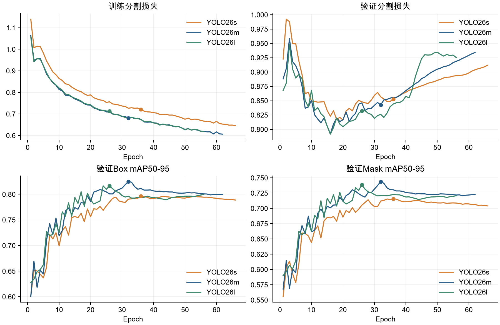

| 模型 | 最佳→末轮 | 训练Mask Loss | 验证Mask Loss | 验证Mask mAP50-95 |
| --- | --- | --- | --- | --- |
| YOLO26s | 36→66 | 0.7216→0.6464 | 0.8528→0.9120 | 0.7157→0.7040 |
| YOLO26m | 32→62 | 0.6815→0.6065 | 0.8427→0.9341 | 0.7439→0.7229 |
| YOLO26l | 26→56 | 0.7132→0.6180 | 0.8321→0.9253 | 0.7387→0.7208 |

三组在最佳轮次之后，训练分割损失继续下降，验证分割损失上升，验证Mask mAP50-95下降，呈现过拟合迹象。均在最佳轮次后30轮正常提前停止。最后一轮权重与最佳权重分别保存，测试采用最佳权重。

这些现象支持保留早停和验证集选模。当前实验不能单独量化数据量、类别不均衡、模型规模或标注表示误差各自的作用，也不能把某次最佳轮数当作所有模型的固定训练长度。


---

## GPU推理速度与精度取舍

图4：Batch=1、FP32平均延迟与测试分割精度。右图纵轴缩放用于展示小幅差异，应结合数值和单次实验限制解读。

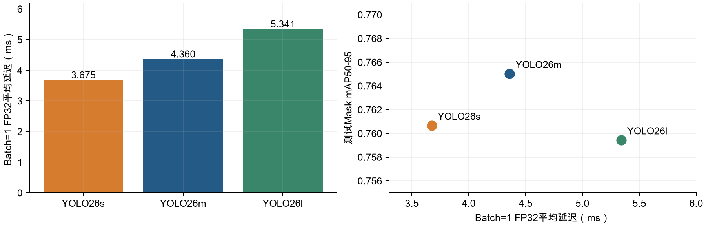

| 项目 | YOLO26s | YOLO26m | YOLO26l |
| --- | --- | --- | --- |
| 样本 / 预热 | 50 / 10 | 50 / 10 | 50 / 10 |
| 平均延迟（ms） | 3.675 | 4.360 | 5.341 |
| 中位延迟（ms） | 3.676 | 4.345 | 5.426 |
| P95延迟（ms） | 3.804 | 4.571 | 5.508 |
| 平均延迟折算FPS | 272.09 | 229.36 | 187.24 |
| 分配显存峰值（GiB） | 0.1138 | 0.2007 | 0.2303 |
| 保留显存峰值（GiB） | 0.1406 | 0.2344 | 0.2656 |

使用同一RTX 4090、相同50张预先解码验证图像、10张预热、imgsz=640、FP32和CUDA同步逐张计时，包含预处理、推理及后处理，排除解码、绘制和视频编码。样本来源清单已核对一致。small、medium在同一流程依次计时，large在较晚时段单独计时。

当前small平均延迟比medium低约15.71%，large比medium高约22.50%。每个模型只计时一组，没有重复测量置信区间，折算FPS不能当作完整视频处理速度。


---

## 相同图像的预测对照（一）

沿用先前随机种子42选出的20张验证样本，按顺序展示前4张。均为各自best.pt，imgsz=640、conf=0.25、Mac CPU预测；显示真实模型输出，不包含人工修正。

样例01：01_VID23_t50_full_t50_VID23_000208.png

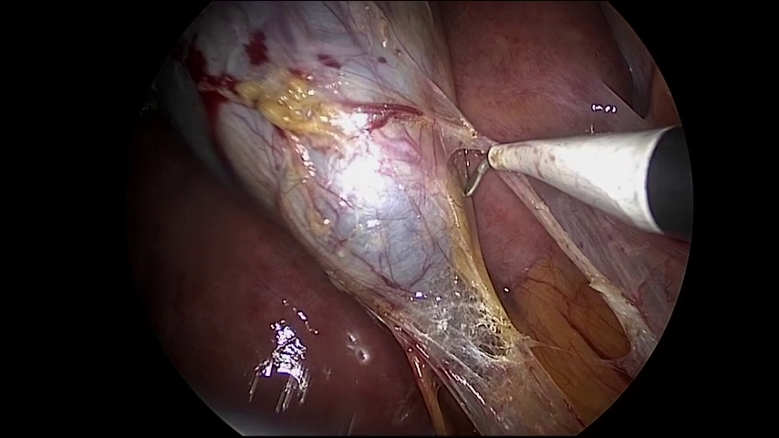


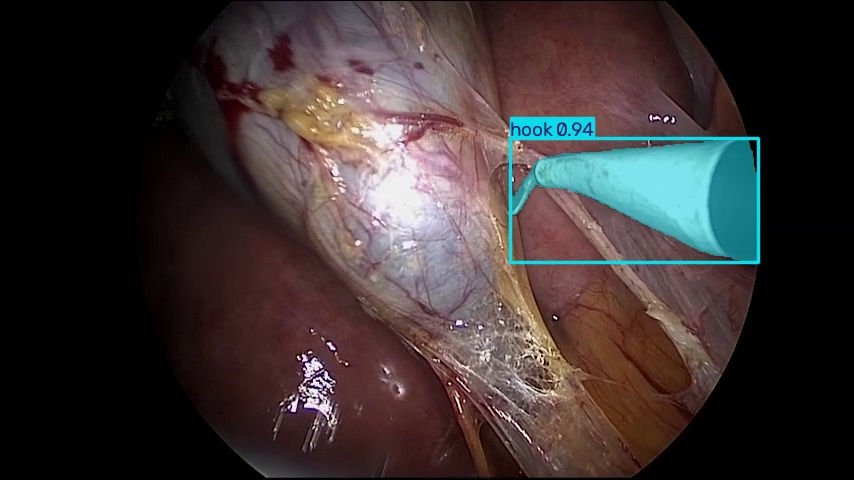

样例02：02_VID11_t80_sparse_t80_VID11_000270.png

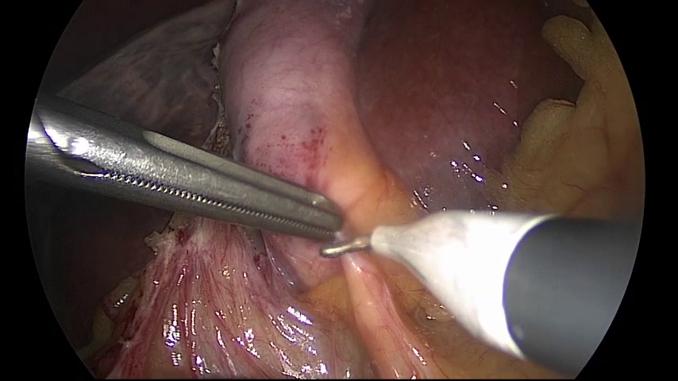


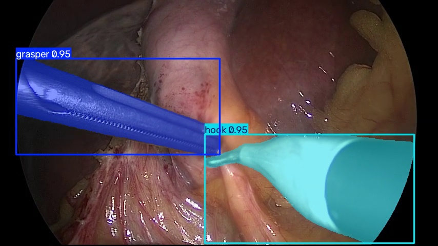


---

## 相同图像的预测对照（二）

沿用先前随机种子42选出的20张验证样本，按顺序展示前4张。均为各自best.pt，imgsz=640、conf=0.25、Mac CPU预测；显示真实模型输出，不包含人工修正。

样例03：03_VID23_t50_full_t50_VID23_001549.png

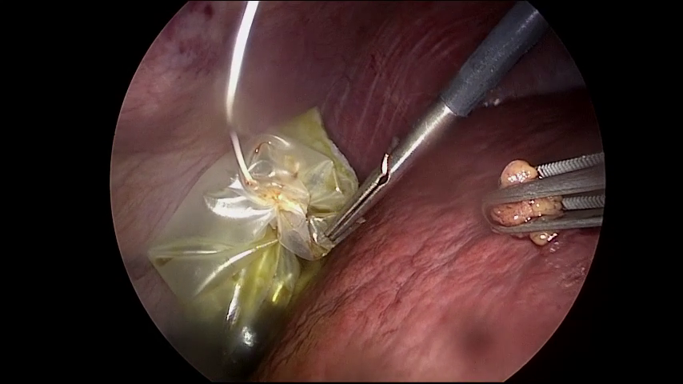


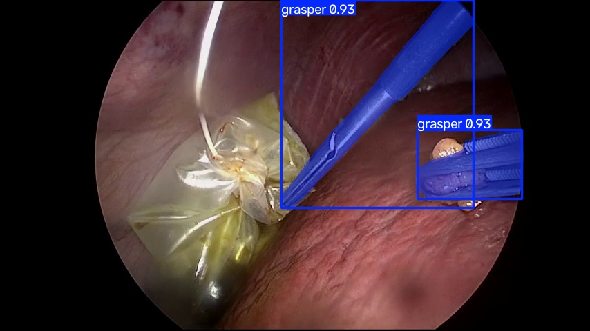

样例04：04_VID23_t50_full_t50_VID23_001302.png

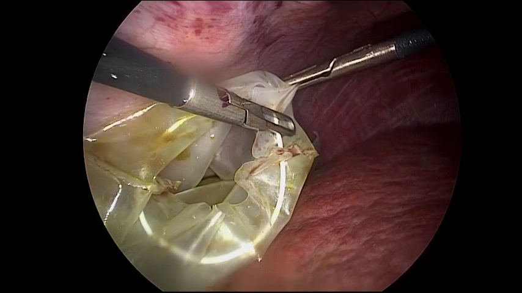

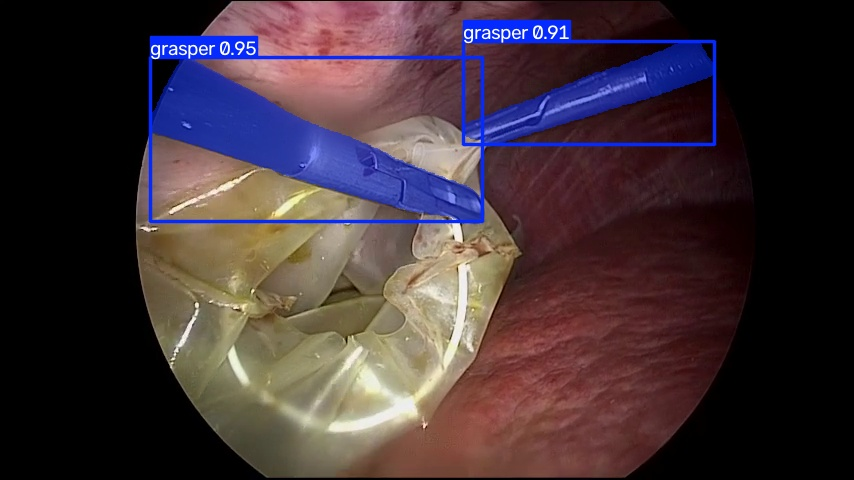


---

## 结果解释与适用范围

在当前划分和统一训练设置下，medium的验证及测试Mask mAP50-95均最高；small训练与推理开销较低，测试分割指标与medium相差约0.436个百分点。large增加了参数量和推理耗时，本次未带来总体分割提升。

精度优先时，当前结果支持使用medium作为候选；资源和延迟优先时，small具有实际价值。large在某些类别上有局部变化，但当前整体证据不足以支持用它替换medium。以上判断限于本次单种子实验。

### 解释边界

三次使用相同batch=16，结果无法回答增大batch是否会改善质量；数据规模没有变化，结果也无法量化扩大数据集的收益。模型容量变化伴随预训练权重及实际早停轮数变化，当前实验比较的是完整微调方案的最终表现。

当前缺少多随机种子重复实验、外部医院或设备测试，以及snare的验证和测试实例。预测示例属于定性展示，没有逐实例人工误差标注，不能据此判断具体模型对所有细节的优劣。

### 复现与材料索引

| 材料 | 本地位置（相对于yolofinetune） |
| --- | --- |
| 三次完整实验 | experiments/2026-11-02_yolo26{s,m,l}_cholec/ |
| small、medium上传材料 | releases/2026-11-02_yolo26s_m_comparison/ |
| large上传材料 | releases/2026-11-02_yolo26l_comparison/ |
| 本报告与支撑指标 | reports/2026-11-03_yolo26_s_m_l_comparison/ |
| 原始数据与YOLO训练数据 | datasets/cholecinstanceseg/ |

本报告目录的source_metrics/分别保存三组CSV、实际配置、最佳验证指标、独立测试及计时JSON；assets/包含原始数值汇编、四幅图表和固定预测对照。完整阶段权重、原生日志与环境依赖保存在各自实验归档。

```bash
.venv/bin/python scripts/run.py train \
  --config configs/rtx4090.yaml --batch 16 \
  --weights weights/yolo26m-seg.pt --name yolo26m-reproduce
```

切换模型时同时更换对应预训练权重和实验名称。复现需要先按项目说明准备数据及CUDA环境。本报告生成过程只读取本地已完成实验，没有启动新训练或远程发布。
